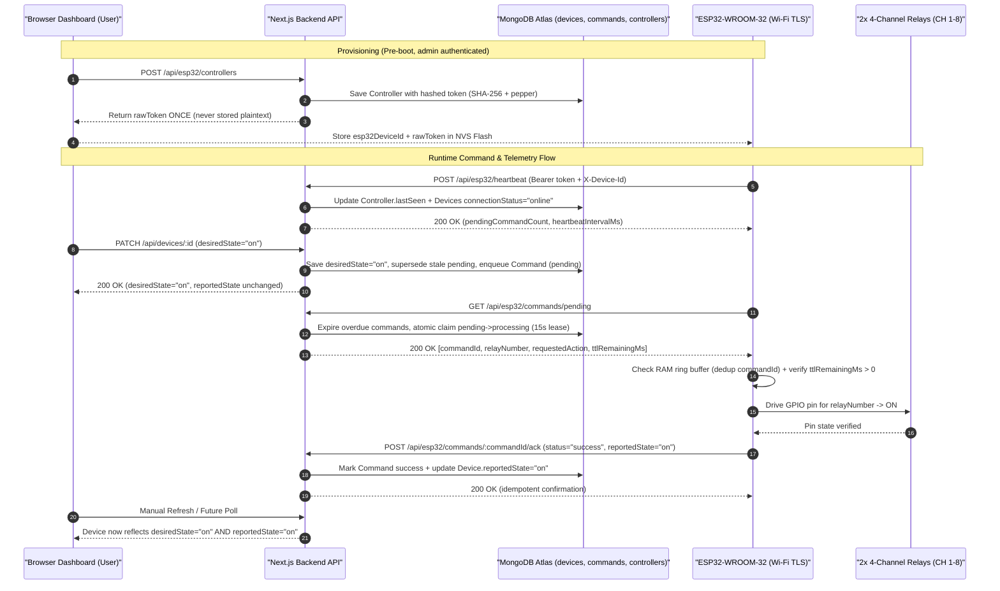
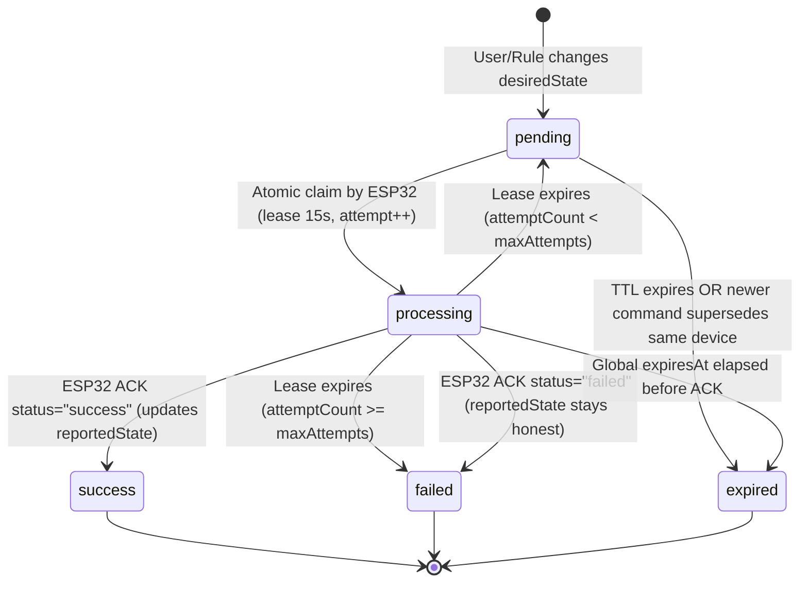

# Architecture

## Overview

`JARVIS` is an AI-powered smart room automation and personal assistant web application built with Next.js App Router, JavaScript, Tailwind CSS, Lucide React, and GSAP.

## Tech Stack

- **Framework:** Next.js (`16.4.6`) with App Router & Turbopack
- **UI Library:** React (`19.3.0`)
- **Language:** JavaScript (ES6+)
- **Styling:** Tailwind CSS (`4.3.3`) via `@tailwindcss/turbopack`
- **Icons:** Lucide React (`1.71.0`)
- **Animation:** GSAP (`3.15.1`)
- **HTTP Client:** Axios (`1.21.1`)
- **Database ODM:** Mongoose (`9.12.1`) for MongoDB Atlas
- **Linting:** ESLint (`eslint-config-next`)

## Directory Structure

```text
jarvis/
├── public/                 # Static assets served from /
├── src/
│   ├── app/
│   │   ├── api/
│   │   │   ├── commands/           # Dev-only Command Queue Route Handlers (403 in production)
│   │   │   │   ├── route.js
│   │   │   │   └── [id]/
│   │   │   │       └── route.js
│   │   │   ├── health/
│   │   │   │   └── route.js        # Live MongoDB health check route handler
│   │   │   ├── rooms/              # Room collection & item CRUD Route Handlers
│   │   │   │   ├── route.js
│   │   │   │   └── [id]/
│   │   │   │       └── route.js
│   │   │   └── devices/            # Device collection & item CRUD Route Handlers
│   │   │       ├── route.js
│   │   │       └── [id]/
│   │   │           └── route.js
│   │   ├── globals.css             # Global design system tokens & HUD layers
│   │   ├── layout.js               # Root layout, metadata, and self-hosted fonts
│   │   └── page.js                 # Mobile-first dashboard entry page
│   ├── components/                 # Reusable layout, dashboard, and UI primitives
│   ├── features/                   # Domain modules
│   │   ├── devices/                # MongoDB-backed Device Management UI
│   │   │   ├── DeviceFormModal.jsx
│   │   │   └── DeviceManagementSection.jsx
│   │   ├── rooms/                  # MongoDB-backed Room Management UI
│   │   │   ├── RoomFormModal.jsx
│   │   │   └── RoomManagementSection.jsx
│   │   ├── assistant/
│   │   └── automation/
│   ├── hooks/                      # Client React hooks for API state & CRUD
│   │   ├── useCollectionResource.js
│   │   ├── useDevices.js
│   │   └── useRooms.js
│   ├── lib/
│   │   ├── api/
│   │   │   └── client.js           # Reusable Axios instance & ApiError normalizer
│   │   ├── db/
│   │   │   └── connect.js          # Cached Mongoose connection utility
│   │   ├── utils/                  # Shared API response, error, & validation helpers
│   │   │   ├── apiResponse.js
│   │   │   └── validation.js
│   │   └── motion.js               # GSAP reduced-motion and pointer capability helpers
│   ├── models/                     # Mongoose database schemas & models
│   │   ├── Command.js              # Hardware command queue, leases, TTL & idempotency
│   │   ├── User.js                 # User profile, preferences, optional auth hash
│   │   ├── Room.js                 # Multi-room definitions scoped by ownerId
│   │   └── Device.js               # Smart devices with desired vs reported state
│   ├── services/                   # Client HTTP API services & server DB services
│   │   ├── commandService.js       # Backend Command queue, lifecycle & lease claims
│   │   ├── deviceApi.js            # Frontend Axios service for /api/devices
│   │   ├── deviceService.js        # Backend Mongoose service for Device operations
│   │   ├── roomApi.js              # Frontend Axios service for /api/rooms
│   │   └── roomService.js          # Backend Mongoose service for Room operations
│   └── types/                      # Shared type/schema definitions directory
├── docs/
│   ├── ROADMAP.md          # Planned milestones and task tracking
│   └── ARCHITECTURE.md     # System, folder, and design system architecture
├── README.md               # Project overview and setup instructions
├── .env.example            # Template for environment variables
├── .gitignore              # Git ignore rules
└── package.json            # Dependencies and npm scripts
```

## Configuration Notes

- **Source directory (`src/`):** Application code lives under `src/`, with the `@/*` path alias mapped to `./src/*` in `jsconfig.json`.
- **Next.js features (`next.config.mjs`):** `cacheComponents`, `partialPrefetching`, and `experimental.agentFeedback` are enabled alongside Turbopack CSS handling.
- **Environment variables:** Copy `.env.example` to `.env.local` for local overrides; `.env*` files except `.env.example` are gitignored.
- **Database & API status:** `src/lib/db/connect.js`, `src/app/api/{health,rooms,devices,commands}`, `src/lib/utils/{apiResponse,validation}.js`, `src/services/{roomService,deviceService,commandService}.js`, `src/models/{User,Room,Device,Command}.js`, and live frontend dashboard integration (`useRooms`, `useDevices`) are implemented and verified against MongoDB Atlas. `/api/commands*` endpoints return `403` in `NODE_ENV === "production"` until user/device auth lands; authentication, `Controller` provisioning, `/api/esp32/*` routes, and ESP32 hardware communication remain pending (the current CRUD APIs are development-only).

---

## Frontend Design System

### Design Philosophy

The JARVIS interface draws inspiration from futuristic Iron Man HUD systems while staying minimal, crisp, and practical for everyday smart-room control. Contrast, clear visual hierarchy, and touch ergonomics take priority over heavy visual effects—cyan accents and subtle glows highlight active states and telemetry without overwhelming readability.

### Color Palette

Defined as global CSS custom properties in `src/app/globals.css` and mapped to Tailwind theme tokens via `@theme inline`:

| Token | CSS Variable | Hex Value | Usage |
| --- | --- | --- | --- |
| Background | `--bg-primary` | `#05080F` | App canvas and viewport base |
| Surface | `--bg-surface` | `#0B1220` | Cards, panels, navigation containers |
| Primary Cyan | `--accent-cyan` | `#00E5FF` | Active states, focus rings, subtle HUD glows |
| Secondary Blue | `--accent-blue` | `#1677FF` | Secondary actions, supportive accents |
| Primary Text | `--text-primary` | `#EAFBFF` | Headings and primary body copy |
| Muted Text | `--text-muted` | `#8295A8` | Secondary labels, metadata, timestamps |

### Typography

Loaded and self-hosted in `src/app/layout.js` via `next/font/google` with CSS variables:

- **Headings & Branding (`Orbitron` / `--font-orbitron`):** Exposed as `--font-display` / `.font-display` and applied to `h1`–`h4` for technical HUD headers and JARVIS branding.
- **Body & Interface Text (`Inter` / `--font-inter`):** Exposed as `--font-sans` and applied globally to `body` for high legibility on small mobile screens and dense controls.

### Styling Approach

- **Tailwind CSS v4 (`@import "tailwindcss";`):** Primary styling layer for components and layout utilities, extended through `@theme inline` tokens (`bg-background`, `bg-surface`, `text-foreground`, `text-muted`, `font-sans`, `font-display`).
- **Global Reset & Accessibility (`@layer base`):** Box-sizing reset, dark `color-scheme`, smooth scrolling (honoring `prefers-reduced-motion: reduce`), custom thin scrollbars, cyan text selection, and high-contrast `:focus-visible` outlines.
- **Reusable HUD Layers (`@layer components` & `@utility`):** Surface and grid helpers (`.hud-surface`, `.hud-surface-elevated`, `.bg-hud-grid`, `.hud-container`) live in `@layer components` so Tailwind utilities (`border-x-0`, `border-b-0`, `border-white/10`) cleanly override defaults, while border, divider, and glow primitives (`.hud-border`, `.hud-border-active`, `.hud-divider`, `.glow-cyan-sm`, `.glow-cyan`, `.glow-cyan-text`) use Tailwind v4 `@utility` declarations so responsive variants (`md:hud-border-active`, `md:glow-cyan-sm`) compile properly.

### Responsive Design Strategy

- **Mobile-first baseline (`360px`, `390px`, `430px`):** Styles, `16px` root typography, `100dvh` height, `touch-action: manipulation`, safe-area bottom insets (`pb-[calc(6rem+env(safe-area-inset-bottom))]`), and `.hud-container` (`1rem` horizontal padding) prioritize smartphones without horizontal clipping or overflow.
- **Tablet & Desktop scaling (`768px`, `1440px`):** At `md` (`768px`), device cards expand to a 4-column row and `BottomNav` floats as a centered `max-w-md` dock with full cyan borders (`md:hud-border-active`). At `lg` (`1024px`–`1440px+`), `.hud-container` caps at `80rem` and renders a balanced 12-column cockpit (`AICore` on the left 5 columns; `RoomOverview` and a `2x2` `DeviceCard` matrix on the right 7 columns).

### GSAP Animation Architecture

Global CSS avoids heavy keyframe animations and conflicting CSS `transform` transitions on GSAP-managed nodes. Client components orchestrate all HUD motion via **GSAP**:

- **Dashboard Entrance (`src/app/page.js` & `src/features/devices/DeviceManagementSection.jsx`):** On mount, `page.js` runs a coordinated `gsap.timeline()` for `[data-gsap="header"]`, `[data-gsap="ai-core"]`, and `[data-gsap="room-overview"]`, while `DeviceManagementSection` staggers `[data-gsap="device-card"]` once initial database records finish loading (avoiding missing-target warnings during async fetch).
- **AI Core (`src/components/dashboard/AICore.jsx`):** Infinite multi-speed concentric ring rotations (`outerRingRef` 34s, `middleRingRef` -22s, `innerRingRef` 15s) keeping central `JARVIS` branding stationary, combined with a gentle glow breathing pulse (`glowRef`) and a circular `closest-side` masked radial scanning sweep (`scanBeamRef`).
- **Device Card Micro-Interactions (`src/components/dashboard/DeviceCard.jsx`):** Pointer-gated desktop hover lift (`supportsHover()`), press scale feedback scoped to the switch button (preventing accidental scale triggers while scrolling on touchscreens), and toggle-triggered icon badge/status dot pops.

#### Lifecycle, Cleanup & Reduced Motion

- Every `useEffect` animation block runs inside `gsap.context(..., containerRef)` and reverts cleanly on unmount via `ctx.revert()`, while `DeviceCard` also calls `gsap.killTweensOf(cardEl)` on unmount so mid-interaction hover/press tweens cannot outlive the element.
- `src/lib/motion.js` exposes `prefersReducedMotion()` and `supportsHover()`. `AICore` subscribes to `matchMedia("(prefers-reduced-motion: reduce)")` change events so toggling reduced motion dynamically stops/reverts or restores continuous GSAP loops without a reload.

---

## Dashboard Component Architecture

The mobile-first dashboard (`src/app/page.js`) connects layout, HUD, Room Management, and Device Management components to live MongoDB Atlas CRUD APIs via the Step 15 client hooks (with ESP32 hardware actuation, AI assistant, and authentication remaining pending):

```text
src/app/page.js (Live Hook Coordinator: useDevices + useRooms)
├── components/layout/Header.jsx
├── components/dashboard/AICore.jsx
├── components/dashboard/RoomOverview.jsx
├── features/rooms/RoomManagementSection.jsx
│   └── features/rooms/RoomFormModal.jsx (Create / Edit Room)
├── features/devices/DeviceManagementSection.jsx
│   ├── components/dashboard/DeviceCard.jsx (MongoDB devices)
│   └── features/devices/DeviceFormModal.jsx (Create / Edit Device)
├── components/layout/BottomNav.jsx
└── lib/motion.js (Motion capability helpers)
```

### Component Responsibilities

- **`src/app/page.js`:** Fetches `allDevices` via `useDevices()` and `rooms` via `useRooms()` once with zero mock data, computes unified `dashboardSummary` (`totalRooms`, `totalDevices`, `desiredOnCount`, `typeCounts`, `connectionCounts`, `reportedCounts`, `devicesByRoom`), derives `effectiveFilterRoomId` to auto-clear stale filters if a selected room disappears after refresh, derives client-only `lastSyncedAt` to avoid SSR hydration mismatches, resets active room filters if the filtered room is deleted, exposes coordinated `handleRefreshAll`, animates shell landmarks on mount, and arranges the 12-column responsive layout grid (`AICore` + `RoomOverview` on the left; `RoomManagementSection` + `DeviceManagementSection` on the right).
- **`src/components/layout/Header.jsx`:** Compact sticky HUD header displaying the `JARVIS` wordmark, `ROOM OS · LIVE DB` subtitle, live backend sync state (`API Ready`, `Syncing`, `Offline`), an accessible manual dashboard refresh button, and a disabled profile preview button.
- **`src/components/layout/BottomNav.jsx`:** Fixed bottom navigation bar with safe-area padding and floating dock styling at `md+`. Only `Home` (`/`) is interactive; `Assistant`, `Automation`, and `Settings` render as disabled placeholders.
- **`src/components/dashboard/AICore.jsx`:** Hero circular HUD centerpiece with concentric cyan/blue rings, stationary `JARVIS` branding, `SYSTEM STANDBY` / `SYNC ERROR` indicator, `{totalRooms} Room(s)` and `{desiredOnCount}/{totalDevices} Desired ON` pills, and GSAP rotation/pulse/scan loops.
- **`src/components/dashboard/RoomOverview.jsx`:** Live MongoDB-backed Dashboard & Room Overview card displaying `DB Synced` / `Syncing` / `Error` status, client sync timestamp, manual refresh button, `Total Rooms` / `Devices` / `Desired ON` totals, explicit `HW Online` / `Offline` / `Unknown` connection counts, separate `Reported State` breakdown, `Device Types Summary` (`light`, `fan`, `led`, `other`), grouped `Rooms Overview` listing all rooms (including `0 Devices` handling) with click-to-filter & smooth navigation to `#devices-section` and `#rooms-section`, plus loading, error+retry, and empty states.
- **`src/features/rooms/RoomManagementSection.jsx`:** Anchored at `#rooms-section` (`scroll-mt-20`), consumes shared `devicesByRoom` (or falls back cleanly when standalone), displays all persisted rooms with name, description, accurate device count badge, associated device chips (`name` + `desiredState`), quick room filter toggle, loading/empty/retryable-error states, GSAP card entrance stagger, and two-step delete confirmation surfacing backend `409` protection whenever devices remain assigned.
- **`src/features/rooms/RoomFormModal.jsx`:** Accessible modal form supporting room creation and editing (`name` required 1–80 chars, `description` optional 0–300 chars) with client validation and backend `ApiError` feedback.
- **`src/components/dashboard/DeviceCard.jsx`:** Displays a persisted MongoDB device (`name`, `type`, resolved `roomName`, `connectionStatus`, `desiredState`, `reportedState`, optional `esp32DeviceId`/`relayNumber`), keeping `Desired State`, `Reported State`, and `Connection Status` visually and textually separate (reserving active cyan glow strictly for confirmed `reportedState === "on"`), accessible `desiredState` switch (`aria-pressed`), inline delete confirmation, Edit/Delete actions, and GSAP micro-interactions.
- **`src/features/devices/DeviceManagementSection.jsx`:** Anchored at `#devices-section` (`scroll-mt-20`), renders room/type filter controls, refresh/add buttons, success/error feedback banners, loading skeletons, retryable error panel, empty states, staggered card animations, and `DeviceFormModal`.
- **`src/features/devices/DeviceFormModal.jsx`:** Accessible modal form supporting both device creation and editing with client-side validation (required name/room, integer relay 1–32), backend error surfacing, and explicit messaging that `desiredState` records MongoDB intent until ESP32 sync exists.
- **`src/lib/motion.js`:** Minimal shared helpers (`prefersReducedMotion`, `supportsHover`) preventing duplicated media-query checks across animated components.

---

## Backend Architecture

### Architectural Approach

JARVIS implements its backend inside the existing Next.js App Router using **Next.js Route Handlers** (`src/app/api/`) rather than maintaining a separate Express server. Database operations are isolated from React UI components, and business logic is decoupled from HTTP route handlers so API endpoints stay thin, modular, and testable.

*(Current state: Mongoose connection caching, health check, schemas, shared validation/response utilities, and Room/Device CRUD services & Route Handlers are implemented and verified against MongoDB Atlas. Authentication, user APIs, and ESP32 communication remain pending.)*

### Backend Folder Responsibilities

- **`src/app/api/`:** Thin Next.js API Route Handlers (`commands/route.js`, `commands/[id]/route.js`, `health/route.js`, `rooms/route.js`, `rooms/[id]/route.js`, `devices/route.js`, `devices/[id]/route.js`) calling `await connection()` on `GET` handlers for dynamic execution under `cacheComponents: true`, parsing JSON/params/query filters, invoking services, and returning uniform responses. Public `User` creation and `/api/esp32/*` routes remain omitted until authentication is implemented, and `/api/commands*` endpoints return `403 Forbidden` whenever `NODE_ENV === "production"`.
- **`src/lib/db/`:** Database connection utility (`src/lib/db/connect.js`) maintaining a reusable cached Mongoose connection to MongoDB Atlas.
- **`src/lib/utils/`:**
  - `apiResponse.js`: `ServiceError`, `successResponse()`, `errorResponse()`, and centralized `handleApiError()` mapping `ServiceError`, malformed JSON `SyntaxError`, Mongoose `ValidationError`/`CastError`, MongoDB `11000` duplicate-key conflicts (`409`), and `DB_*` errors without leaking stack traces or connection URIs.
  - `validation.js`: `parseJsonBody()`, `assertValidObjectId()`, `assertValidCommandId()`, field allowlists preventing mass assignment (`validateCreateRoomPayload`, `validateUpdateRoomPayload`, `validateCreateDevicePayload`, `validateUpdateDevicePayload`, `validateDeviceQueryFilters`, `validateCreateCommandPayload`, `validateCommandQueryFilters`), and `DEFAULT_DEV_OWNER_ID` (`000000000000000000000001`) as a temporary pre-auth owner fallback.
- **`src/models/`:** Mongoose database models (`User.js`, `Room.js`, `Device.js`, `Command.js`) defining persistent MongoDB schemas, validation, and indexes outside route handlers, guarded via `mongoose.models.<Name> || mongoose.model(...)` to prevent `OverwriteModelError`.
- **`src/services/`:**
  - `roomService.js`: Room CRUD (`listRooms`, `createRoom`, `getRoomById`, `updateRoomById`, `deleteRoomById`), enforcing safe deletion (`409 Conflict` if `Device.countDocuments({ roomId }) > 0`).
  - `deviceService.js`: Device CRUD (`listDevices`, `createDevice`, `getDeviceById`, `updateDeviceById`, `deleteDeviceById`), validating referenced `Room` existence, inheriting `ownerId` from the verified room, keeping hardware-owned telemetry (`reportedState`, `connectionStatus`, `lastSeen`) read-only via public CRUD, and never equating `desiredState` updates with physical relay actuation.
  - `commandService.js`: Command Queue & Lifecycle domain service implementing `assertDevOnlyCommandApiAccess()`, `enqueueCommand()` (validates mapped `esp32DeviceId`/`relayNumber`, `on`/`off` action, idempotent replay/conflict handling, and supersedes older pending commands), `expireStaleCommands()`, `listCommands()`, `getCommandById()`, plus internal controller-auth-ready lifecycle transitions `claimPendingCommands()` (atomic `findOneAndUpdate` `15s` leases, max `3` attempts) and `acknowledgeCommand()` (enforces target ownership, blocks expired/terminal double-ACKs with `409`, and updates `Device.reportedState` + `connectionStatus` only on verified hardware results).

### Database Models & Relationships (`src/models/`)

1. **`User` (`src/models/User.js`):**
   - Stores `name`, unique normalized `email` (`lowercase`, `trim`, format regex), optional `passwordHash` (`select: false` so queries never return hashes by default), structured `preferences` defaults (`theme: "dark"`, `voiceFeedback: true`, `reducedMotion: false`, `notificationsEnabled: true`), and `timestamps`.
2. **`Room` (`src/models/Room.js`):**
   - Stores `name`, optional `description`, `ownerId` (`ObjectId` referencing `User`), and `timestamps` to support multi-room ownership.
3. **`Device` (`src/models/Device.js`):**
   - Stores `name`, `type` (`light | fan | led | other`), `roomId` (`ObjectId` -> `Room`), `ownerId` (`ObjectId` -> `User`), optional ESP32 hardware mapping (`esp32DeviceId`, integer `relayNumber` 1–32), `desiredState` (`on | off`, default `off`), `reportedState` (`on | off | unknown`, default `unknown`), `connectionStatus` (`online | offline | unknown`, default `unknown`), `lastSeen` (`Date`), and `timestamps`.
4. **`Command` (`src/models/Command.js` — Implemented Step 22):**
   - Stores `commandId` (unique UUIDv4 `cmd_...`), `deviceId` (`ObjectId` -> `Device`), `esp32DeviceId` (`String`), `ownerId` (`ObjectId` -> `User`), `relayNumber` (`Integer` 1–32), `action` (`on | off`), `status` (`pending | processing | success | failed | expired`), `attemptCount` (`0..maxAttempts`), `maxAttempts` (default `3`), `processingStartedAt`, `processingUntil` (lease deadline), `expiresAt` (execution cutoff), `retainUntil` (30-day archive cutoff), `executedAt`, `result`, `errorReason`, optional `idempotencyKey`, and `timestamps`.

#### Relationships & State Model

- **Relationships:** Uses normalized `ObjectId` references (`User` 1 → N `Room` via `Room.ownerId`; `Room` 1 → N `Device` via `Device.roomId`; `User` 1 → N `Device` via `Device.ownerId`; `Device` 1 → N `Command` via `Command.deviceId`) rather than deep embedded arrays.
- **`desiredState` vs. `reportedState`:** Kept strictly independent. Creating a `pending` `Command` never updates `Device.reportedState`; only `acknowledgeCommand(..., { status: "success" })` updates `reportedState` and `connectionStatus: "online"` (while `failed` preserves prior/honest hardware state).

#### Key Indexes & Validation

- **`User`:** Unique index on `email`, trimmed/lowercased email validation, and `select: false` on `passwordHash`.
- **`Room`:** Compound unique index `{ ownerId: 1, name: 1 }` accelerating per-user room queries and preventing duplicate room names under the same owner.
- **`Device`:** Compound indexes `{ ownerId: 1, roomId: 1 }` and `{ roomId: 1, desiredState: 1 }` for room/owner lookups, plus a partial unique index `{ esp32DeviceId: 1, relayNumber: 1 }` (applied only when both `esp32DeviceId` is a string and `relayNumber` is a number) preventing relay pin collisions on paired ESP32 boards while allowing multiple devices per ESP32 and unmapped devices.
- **`Command`:** Unique `{ commandId: 1 }`, poll-claim index `{ esp32DeviceId: 1, status: 1, expiresAt: 1, createdAt: 1 }`, history/supersede index `{ deviceId: 1, status: 1, createdAt: -1 }`, partial unique `{ idempotencyKey: 1 }` (`$type: "string"`), and MongoDB TTL index `{ retainUntil: 1 }` (`expireAfterSeconds: 0`) for 30-day diagnostic log purging without prematurely deleting freshly `expired` commands.

### Mongoose Connection Architecture (`src/lib/db/connect.js`)

- **Reusable Connection Caching:** Next.js development hot reloads and serverless route invocations re-evaluate module scopes frequently. `connectDB()` stores `{ conn: null, promise: null }` on `globalThis._mongooseCache` so concurrent cold-start requests share one pending connection promise (`readyState === 2`) and warm invocations reuse the active connection (`readyState === 1`). When a thawed serverless instance wakes with a dropped socket (`readyState === 0` or `3`), both `cached.conn` and stale `cached.promise` are cleared cleanly before reconnecting.
- **Connection Safeguards:** Calls `mongoose.connect(mongoUri, { bufferCommands: false, maxPoolSize: 10, serverSelectionTimeoutMS: 5000 })` to avoid long hangs, silent buffering, or exhausting Atlas M0/Flex connection quotas across concurrent Vercel lambdas. Failed promises reset `cached.promise = null` and `cached.conn = null` so later requests can recover.
- **Error Classification & Secret Safety:** Missing `MONGODB_URI`, authentication failures (codes `18`/`8000`), invalid URI formats, and network/server-selection errors are mapped to safe error codes (`DB_MISSING_URI`, `DB_AUTH_FAILED`, `DB_INVALID_URI`, `DB_NETWORK_ERROR`, `DB_CONNECTION_FAILED`). Connection strings and credentials are never logged or returned.

### Health Endpoint Behavior (`GET /api/health`)

- **Dynamic Per-Request Execution:** Calls `await connection()` from `next/server` so Next.js `cacheComponents: true` defers execution to request time instead of prerendering stale database state during `next build`.
- **Live Connectivity Ping & Recovery:** Calls `connectDB()` and verifies `mongoose.connection.readyState === 1` followed by `mongoose.connection.db.admin().ping()` so stale sockets are caught immediately. Any post-connection failure resets the cached connection via `resetConnectionCache()` and passes through `classifyConnectionError()` before responding.
- **Responses:**
  - Connected and ping succeeds: returns HTTP `200` with `{ "success": true, "message": "JARVIS backend is healthy", "database": "connected" }`.
  - Disconnected or error (missing `MONGODB_URI`, malformed URI, invalid credentials, network failure): returns HTTP `503` (or `500` for malformed URI) with `{ "success": false, "message": "...", "database": "disconnected", "error": "..." }` and never leaks connection credentials.

### Frontend-to-Backend-to-Database Data Flow

```text
React Client UI (src/app / src/components / src/features)
        │  State & Actions
        ▼
Custom React Hooks (src/hooks/useDevices.js, useRooms.js -> useCollectionResource.js)
        │  AbortController + Stale-Response Guard
        ▼
Client API Services (src/services/deviceApi.js, roomApi.js)
        │  Axios Instance (src/lib/api/client.js -> NEXT_PUBLIC_API_BASE_URL || "/api")
        ▼
Next.js Route Handlers (src/app/api/*)
        │  Input Validation + Auth Guard (lib/utils, future auth)
        ▼
Server Service Layer (src/services/roomService.js, deviceService.js)
        │  Domain Rules & Orchestration
        ▼
Database Layer (src/lib/db/connect.js + src/models/*)
        │  Cached Mongoose Connection
        ▼
MongoDB Atlas
```

### Frontend API Integration Architecture

- **Axios Instance (`src/lib/api/client.js`):** Configures `baseURL` (`process.env.NEXT_PUBLIC_API_BASE_URL || "/api"`), `10000ms` timeout, JSON headers, and request/response interceptors. Responses are unwrapped from `{ success, message, data }`, while network failures, timeouts (`ECONNABORTED`), aborted requests (`ERR_CANCELED`), and HTTP errors are normalized into `ApiError` instances.
- **Client Services (`src/services/deviceApi.js`, `src/services/roomApi.js`):** Provide focused methods for `get*`, `get*ById`, `create*`, `update*`, and `delete*` endpoints with clean query-parameter filtering (`cleanParams`) and `AbortSignal` passthrough, completely isolated from Mongoose server services.
- **Custom Hooks (`src/hooks/useDevices.js`, `src/hooks/useRooms.js`):** Built atop `src/hooks/useCollectionResource.js` (`"use client"`). Serialize primitive filters into a stable `filterKey` to avoid duplicate fetches on re-render, schedule auto-fetch cleanly on microtask (avoiding React Strict Mode double fetches and synchronous `setState`-in-effect warnings), cancel superseded requests with `AbortController`, abort older pending GETs whenever mutations run (`invalidatePendingFetches`), track client-side `lastFetchedAt`, separate collection fetch `error` from `mutationError` (so rejected mutations such as `409` delete blocks keep existing room/device lists visible), and track monotonic `requestIdRef` counters so stale responses cannot overwrite fresh state. Now actively integrated across the Main Dashboard, Room Management, and Device Management views.

### Security Principles

- **Environment-Based Configuration:** Connection strings and secrets (such as `MONGODB_URI`) live exclusively in `.env.local` (documented in `.env.example`) and are never committed (`.env*` ignored in `.gitignore`).
- **Secret Protection:** Database URIs, tokens, and API secrets remain strictly server-side (never prefixed with `NEXT_PUBLIC_`, never bundled into client components, and never echoed in API responses or logs).
- **Input Validation & Mass-Assignment Protection:** `src/lib/utils/validation.js` strictly allowlists permitted fields (`name`, `description` on rooms; `name`, `type`, `roomId`, `esp32DeviceId`, `relayNumber`, `desiredState` on devices), enforces strict 24-character hex `ObjectId` format (`assertValidObjectId`), integer relay bounds (`1`–`32`), and enums, and ignores/rejects unpermitted fields like `reportedState`, `ownerId` mutations, or `_id`. Additionally, `updateDeviceById` checks target device existence (`404 Device not found`) before validating a reassigned `roomId`.
- **Consistent API Responses & Error Handling:** `src/lib/utils/apiResponse.js` enforces uniform `{ success, message, data? }` / `{ success, message, errors? }` envelopes (`200`/`201`/`400`/`404`/`409`/`500`/`503`) and strips stack traces and database credentials.
- **Development-Only Scope & Future Auth:** Authentication and authorization are not yet implemented; current Room/Device APIs are strictly for local development and must not be deployed publicly without session verification and `ownerId` scoping.

### Integration Verification (Steps 18–20)

- **Full-Stack Verified Behavior:** End-to-end verification across five automated suites against live `next start` + MongoDB Atlas confirmed `.next/static` client bundles (`11` chunks) contain no secrets, API endpoints reject malformed JSON/array/ID/type/relay payloads (`400`), nonexistent targets (`404`), and duplicate rooms or `(esp32DeviceId, relayNumber)` pairs (`409`), mass-assignment attempts cannot forge `reportedState` or `connectionStatus`, `connectDB`/`classifyConnectionError` map auth/network/URI/missing-env failures safely (`500`/`503`), `User.passwordHash` enforces `select: false` with `/api/users` unexposed (`404`), React `StrictMode` mounts deduplicate initial `GET` requests, Main Dashboard metrics match live collections, zero-device rooms and room-to-device drill-down work, manual refresh syncs out-of-band DB changes and auto-recovers stale deleted-room filters (`effectiveFilterRoomId`), `Escape` dismisses modals, zero unexpected `console.error` calls occur, and real persisted records remain intact.
- **Known Limitations & Manual Verification:** Live Chrome interactive checks (`360px`–`1440px` responsive rendering, non-reduced-motion GSAP animations, and keyboard Tab order), authentication/authorization (`ownerId` session enforcement—do not expose development CRUD APIs publicly without auth), and ESP32 hardware communication remain pending.

### Vercel Deployment Architecture & Audit (Step 23 Verified)

- **Serverless Runtime Compatibility:** `/` and `/_not-found` compile statically, while all API Route Handlers (`/api/health`, `/api/rooms*`, `/api/devices*`, `/api/commands*`) run as Vercel Node.js Serverless Functions (`await connection()` from `next/server` under `cacheComponents: true`). No local filesystem writes (`fs`), background `setInterval` workers, Edge runtime conflicts, or hardcoded `localhost` API URLs exist in `src/`.
- **Environment Variable Boundaries:** Only `MONGODB_URI` (server-only) is required at runtime; `NEXT_PUBLIC_API_BASE_URL` defaults safely to same-origin `"/api"` inside `src/lib/api/client.js`. Static bundle inspection confirms zero server secrets appear in `.next/static` chunks, and `.env.local` stays excluded via `.gitignore`.
- **Atlas Serverless Requirements:** Configure MongoDB Atlas Network Access for Vercel dynamic egress (pair with dedicated credentials + TLS) and rely on `connect.js` (`maxPoolSize: 10`, stale-socket cache clearing) to bound per-lambda pools.
- **API Production Readiness Classification:**
  - `GET /api/health` — Public health check (`200`/`500`/`503` safe payload, no secrets).
  - `GET / POST /api/commands` & `GET /api/commands/[id]` — Locked to `403 Forbidden` when `NODE_ENV === "production"` (`assertDevOnlyCommandApiAccess()`).
  - `/api/rooms*` & `/api/devices*` — **Authentication Blocker:** Still unauthenticated (`DEFAULT_DEV_OWNER_ID` fallback). Must be protected behind **Vercel Deployment Protection** for private staging or gated by user auth & `ownerId` session enforcement before any public production launch.

---

## ESP32 Communication Architecture (Step 21 Design — Not Yet Implemented)

> **Status Distinction:** Sections below define the finalized **Step 21 engineering design**. None of the `/api/esp32/*` endpoints, `Controller`/`Command` models, token rotation handlers, or ESP32 firmware exist yet in `src/`. Current implementation stops at verified MongoDB Room/Device CRUD (`desiredState` vs read-only `reportedState` / `connectionStatus`).

### Architectural Decisions & Transport Modularity

- **Central Server Role:** Next.js App Router Route Handlers act as the sole hardware gateway (`ESP32 <-> HTTPS REST APIs <-> Service Layer <-> MongoDB Atlas`). ESP32 nodes connect via Wi-Fi and never hold `MONGODB_URI` or talk directly to MongoDB.
- **Polling Baseline (Phase 4 HTTPS REST):** Each physical controller (`ESP32-WROOM-32`) maintains Wi-Fi TLS 1.2+ connectivity, sends periodic heartbeats, polls for pending commands (`2s`–`5s` jittered interval), executes relay switching on channels `1–8` (two 4-channel modules), and sends idempotent execution acknowledgements and boot/recovery snapshots.
- **Transport-Agnostic Modularity (Future MQTT / WebSocket Ready):** Command queuing, atomic claiming, lease expiration, and acknowledgement logic will live inside server domain services (`commandService.js`, `hardwareService.js`) completely decoupled from HTTP handlers (`/api/esp32/*`). Introducing MQTT or WebSockets later only swaps/adds a delivery trigger while keeping `Command` state transitions, idempotency keys, and `Device` schemas unchanged.

### Hardware Communication Sequence



### Device Authentication & Credential Provisioning

- **Identity Scope:** Authentication binds to a physical **`Controller`** identified by unique `esp32DeviceId` (matching `Device.esp32DeviceId`), where one ESP32 drives `1..8` logical `Device` records.
- **Zero Plaintext Storage:** At provisioning, server CSPRNG (`crypto.randomBytes(32)`) issues a 256-bit bearer secret. Only its peppered hash (`SHA-256` with server env `ESP32_TOKEN_PEPPER`) is stored in `Controller.tokenHash` (`select: false`). Browser clients never receive controller secrets.
- **Verification on Every `/api/esp32/*` Call:** Require HTTPS in production, extract `Authorization: Bearer <token>` and `X-Device-Id`, verify hash with constant-time `crypto.timingSafeEqual`, confirm `Controller.status === "active"`, and reject unauthenticated/revoked requests cleanly with `401 Unauthorized`.
- **Provisioning, Rotation & Revocation:**
  - Provisioning is restricted to an authenticated admin/owner session; the raw secret is returned once at creation and stored on-device in ESP32 **NVS Flash** (never hardcoded in firmware source or repo).
  - Rotation moves current `tokenHash` into `previousTokenHash` with a short expiry window (`previousTokenExpiresAt`) for zero-downtime cutover.
  - Revocation sets `status: "revoked"` and clears hashes, immediately blocking compromised hardware (`401`).

### Command Lifecycle & Idempotency

Every command passes through strictly guarded states (`pending`, `processing`, `success`, `failed`, `expired`):



- **Required Command Fields:** Unique `commandId` (UUIDv4), target `deviceId` (`ObjectId`), `esp32DeviceId`, `relayNumber`, `action` (`"on" | "off"`), `createdAt`, `expiresAt`, `executedAt`, `result`, and `errorReason`.
- **Duplicate & Retry Protection:**
  1. Enqueueing a new intent for `deviceId` atomically marks older `pending` commands for that device as `expired` (`"Superseded by newer command request"`), plus optional `idempotencyKey` prevents duplicate submissions (`200` replay on identical request, `409` on mismatch).
  2. `claimPendingCommands` uses atomic `findOneAndUpdate` claims with a `15s` `processingUntil` lease so concurrent polls never double-dispatch.
  3. Firmware checks `ttlRemainingMs > 0` using monotonic `millis()` (avoiding clock-skew failures) and caches the last `16` `commandId`s in a RAM ring buffer so network retry re-deliveries re-send ACK without re-switching relays.
  4. `acknowledgeCommand` rejects `expired` or already-finalized (`success`/`failed`) acknowledgements with `409 Conflict` and restricts completions to the matching `esp32DeviceId`/`deviceId`.

### Proposed Hardware API Contracts (Future Implementation)

All endpoints reuse `apiResponse.js` (`{ success, message, data? }` / `{ success, message, errors? }`) and distinguish **Implemented** CRUD (`/api/health`, `/api/rooms`, `/api/devices`) from **Proposed Step 22–23** hardware routes:

| Endpoint | Auth | Purpose | Status Codes |
| --- | --- | --- | --- |
| `POST /api/esp32/controllers` | User Session (Admin) | Register controller, return one-time `rawToken` | `201`, `400`, `401`, `409` |
| `POST /api/esp32/controllers/[id]/rotate` | User Session | Rotate controller secret with overlap window | `200`, `401`, `404` |
| `POST /api/esp32/controllers/[id]/revoke` | User Session | Immediately revoke compromised controller token | `200`, `401`, `404` |
| `POST /api/esp32/heartbeat` | Controller Bearer + `X-Device-Id` | Update `lastSeen`, Wi-Fi diagnostics, mark devices online | `200`, `400`, `401`, `429` |
| `GET /api/esp32/commands/pending` | Controller Bearer + `X-Device-Id` | Expire stale items & atomically claim valid pending commands | `200`, `401`, `429` |
| `POST /api/esp32/commands/[commandId]/ack` | Controller Bearer + `X-Device-Id` | Idempotent completion (`success`/`failed`) & `reportedState` sync | `200`, `400`, `401`, `404`, `409` |
| `POST /api/esp32/status` | Controller Bearer + `X-Device-Id` | Boot/recovery multi-channel pin state reconciliation | `200`, `400`, `401`, `429` |

Example contracts:

```json
// POST /api/esp32/controllers -> 201 Created (Admin Session; rawToken shown ONCE)
{
  "success": true,
  "message": "ESP32 controller provisioned",
  "data": {
    "controller": { "_id": "...", "esp32DeviceId": "esp32-room-01", "tokenPrefix": "jrv_esp_9a" },
    "rawToken": "jrv_esp_9a8f...<256-bit-secret>"
  }
}

// POST /api/esp32/heartbeat Request -> 200 OK
// Req: { "firmwareVersion": "1.0.0", "rssi": -58, "uptimeSeconds": 1840, "freeHeapBytes": 194520 }
{
  "success": true,
  "message": "Heartbeat recorded",
  "data": { "pendingCommandCount": 1, "recommendedPollMs": 3000, "serverTime": "2026-11-11T13:10:00.000Z" }
}

// GET /api/esp32/commands/pending -> 200 OK
{
  "success": true,
  "message": "Claimed pending commands",
  "data": [
    {
      "commandId": "cmd_4d2a1b8e-73e1-4c9a-9f12-104c92a01122",
      "deviceId": "6730...",
      "relayNumber": 1,
      "requestedAction": "on",
      "ttlRemainingMs": 85000,
      "expiresAt": "2026-11-11T13:11:25.000Z"
    }
  ]
}

// POST /api/esp32/commands/[commandId]/ack Request -> 200 OK
// Req: { "status": "success", "reportedState": "on", "relayNumber": 1, "executedAt": "2026-11-11T13:10:04.120Z", "result": "Relay CH1 ON" }
{
  "success": true,
  "message": "Command acknowledged",
  "data": { "commandId": "cmd_4d2a1b8e-...", "status": "success", "reportedState": "on" }
}

// POST /api/esp32/status Request -> 200 OK (Power-on / Wi-Fi recovery reconciliation)
// Req: { "bootReason": "power_on", "channels": [{ "relayNumber": 1, "reportedState": "off" }, { "relayNumber": 2, "reportedState": "off" }] }
{
  "success": true,
  "message": "Hardware channel status synced",
  "data": { "updatedDevices": 2, "connectionStatus": "online" }
}
```

### Proposed Database Architecture (Deferred — Do Not Modify Existing Schemas Yet)

Existing `Device` schema (`esp32DeviceId`, `relayNumber`, `desiredState`, `reportedState`, `connectionStatus`, `lastSeen`, and unique partial index `{ esp32DeviceId: 1, relayNumber: 1 }`) requires **no breaking changes** and remains the single source of truth for device state. Step 22 implemented `Command`; `Controller` remains deferred to Step 23:

1. **`Controller` (`src/models/Controller.js` — Proposed Step 23):**
   - Fields: `esp32DeviceId` (unique String), `name`, `ownerId` (`ObjectId` -> `User`), `tokenHash` (`select: false`), `previousTokenHash` (`select: false`), `previousTokenExpiresAt`, `tokenPrefix`, `tokenVersion`, `status` (`"provisioning" | "active" | "revoked"`), `relayConfig` (channels `1..8`: `relayNumber`, `gpioPin`, `activeLevel`, `safeBootState`), `firmwareVersion`, `lastRssi`, `lastBootReason`, `lastSeen`, `timestamps`.
   - Indexes: `{ esp32DeviceId: 1 }` (`unique`), `{ ownerId: 1, status: 1 }`, `{ status: 1, lastSeen: 1 }`.
2. **`Command` (`src/models/Command.js` — Implemented in Step 22):**
   - Fields: `commandId` (unique UUID String), `deviceId` (`ObjectId` -> `Device`), `esp32DeviceId` (String), `ownerId` (`ObjectId` -> `User`), `relayNumber` (Integer 1–32), `action` (`"on" | "off"`), `status` (`"pending" | "processing" | "success" | "failed" | "expired"`), `attemptCount` (default `0`, max `3`), `maxAttempts`, `processingStartedAt`, `processingUntil`, `expiresAt`, `retainUntil` (`Date`), `executedAt`, `result`, `errorReason`, `idempotencyKey`, `timestamps`.
   - Indexes: `{ commandId: 1 }` (`unique`), `{ esp32DeviceId: 1, status: 1, expiresAt: 1, createdAt: 1 }` (poll claim hot-path), `{ deviceId: 1, status: 1, createdAt: -1 }`, partial unique `{ idempotencyKey: 1 }` (`$type: "string"`), and MongoDB TTL index `{ retainUntil: 1 }` (`expireAfterSeconds: 0`, `30d` retention so `expired` commands stay observable for diagnostics before archival purge).

### Network & Failure Handling Strategy

- **Wi-Fi / Internet Outage / Server Down:** Firmware retries with jittered exponential backoff (`2s`–`30s`) preserving current relay latch; backend marks controllers + mapped devices `connectionStatus: "offline"` after missed heartbeats (`> 45s`) without faking `reportedState`.
- **HTTP Timeouts / Repeated Polls:** Atomic `processingUntil` lease (`15s`) limits unacked execution exposure; max `3` attempts before failing; firmware RAM `commandId` ring buffer + server idempotent ACKs block double actuation.
- **Expired Commands:** Server checks `expiresAt` pre-claim and pre-ACK; firmware checks `ttlRemainingMs` via `millis()` so delayed blackout commands transition to `expired` instead of turning appliances on unpredictably later.
- **Relay Failure:** Hardware reports `ack: { status: "failed", reportedState, failureReason }`; `Device.reportedState` remains honest so the UI clearly shows divergence between `desiredState` and physical `reportedState`.
- **ESP32 Restart / Power Recovery:** Relays boot into safe OFF state first (`Controller.relayConfig` `safeBootState: "off"`), then ESP32 sends `POST /api/esp32/status` (`bootReason: "power_on"`) so MongoDB reflects physical reality without auto-energizing unconfirmed loads.

### 8-Channel Relay Mapping & Electrical Fail-Safe Design

- **Hardware Target:** `1 × ESP32 DevKit V1 (ESP32-WROOM-32)` driving `2 × 4-Channel Relay Modules` (`relayNumber 1–4` on Module A, `5–8` on Module B).
- **Configurable Pin Map (No Pin/Polarity Assumptions):** `Controller.relayConfig` explicitly binds `{ relayNumber (1..8), gpioPin, activeLevel ("LOW" | "HIGH"), safeBootState ("off") }`. Exact GPIOs and active-LOW vs active-HIGH trigger polarity (plus 3.3V-to-5V optocoupler driver suitability) must be bench-verified with the physical relay modules before wiring.
- **Pin Exclusions & Safe Boot Sequence:** Avoid boot strapping pins (`GPIO 0, 2, 12, 15`), internal flash (`GPIO 6–11`), UART0 (`GPIO 1, 3`), and input-only pins (`GPIO 34, 35, 36, 39`), preferring clean output-capable candidates (`GPIO 13, 14, 16, 17, 18, 19, 21, 22, 23, 25, 26, 27, 32, 33`) after hardware verification. During setup(), write the `INACTIVE` logic level **before** switching `pinMode(pin, OUTPUT)` (with hardware pull-up/pull-down resistors matching module polarity) to eliminate relay power-on chatter.

### Security & Production Controls

- **Transport & Auth:** Enforce HTTPS/TLS 1.2+ with CA verification on ESP32; keep User session auth strictly separate from hashed ESP32 controller Bearer tokens; block production deployment while pre-auth CRUD fallback exists.
- **Rate Limiting & Payload Hygiene:** Enforce per-controller and per-IP sliding-window limits on `/api/esp32/*` (`429 Too Many Requests`), restrict JSON body sizes (`<= 4KB`), validate channels/actions against schema bounds, and emit sanitized JSON errors (`apiResponse.js`).
- **Replay & Audit Trail:** Single-completion `commandId` machine + short `expiresAt` windows defeat replays; immutable command transitions (`Command` history + failed auth log entries) provide auditable diagnostics.

### Implementation Dependency Order (Steps 22–26)

1. **Step 22 — Command Queue + MongoDB Implementation *(Implemented)*:** `Command` Mongoose schema (`src/models/Command.js`), `commandService.js` (enqueue/supersede, expiry, atomic claim leases, lifecycle transitions, device telemetry ACK separation), and dev-only `/api/commands` & `/api/commands/[id]` endpoints (locked `403` in production).
2. **Step 23 — Auth, `Controller` Provisioning & ESP32 Route Handlers:** Implement user authentication/session scoping (`ownerId`), `Controller` Mongoose model + token hashing/rotation/revocation, `/api/esp32/controllers*`, `/api/esp32/heartbeat`, `/api/esp32/commands/pending`, `/api/esp32/commands/[commandId]/ack`, `/api/esp32/status`, wire `deviceService` state updates to enqueue commands cleanly, and add heartbeat offline staleness sweep.
3. **Step 24 — Admin Provisioning UI & Dashboard Command Telemetry:** Build controller provisioning/token management and surface `Command` lifecycle states (`pending`/`processing`/`success`/`failed`/`expired`) alongside live `reportedState` and `connectionStatus` on the dashboard.
4. **Step 25 — Bench GPIO Verification & ESP32-WROOM-32 Firmware:** Verify relay active polarity & safe GPIO pinout on physical hardware, then implement modular firmware (Wi-Fi TLS, NVS secrets, safe boot init, heartbeat, atomic poll/ack, RAM deduplication, boot/status sync).
5. **Step 26 — Hardware-in-the-Loop QA & Hardening:** Verify full browser-to-relay execution, Wi-Fi/power/timeout/expiry failure recovery, rate limiting, and optional MQTT transport readiness.
