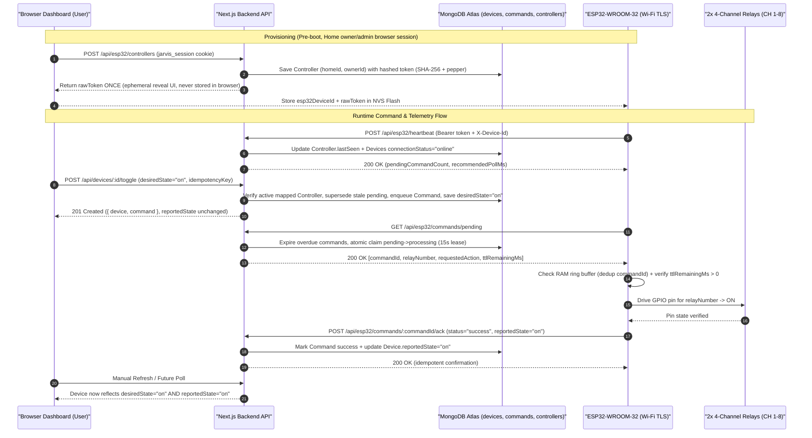
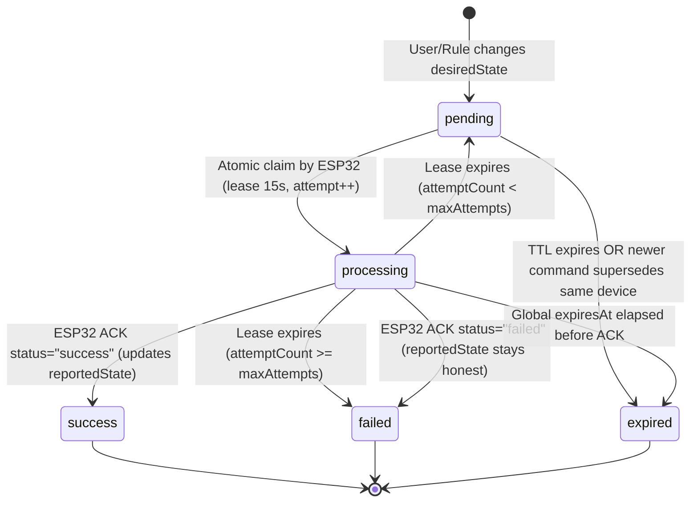

# Architecture

## Overview

`JARVIS` is an AI-powered smart room automation and personal assistant web application built with Next.js App Router, JavaScript, Tailwind CSS, Lucide React, and GSAP.

## Tech Stack

- **Framework:** Next.js (`16.4.6`) with App Router & Turbopack
- **UI Library:** React (`19.3.0`)
- **Language:** JavaScript (ES6+)
- **Styling:** Tailwind CSS (`4.3.3`) via `@tailwindcss/turbopack`
- **Icons:** Lucide React (`1.71.0`)
- **Animation:** GSAP (`3.15.1`)
- **HTTP Client:** Axios (`1.21.1`)
- **Database ODM:** Mongoose (`9.12.1`) for MongoDB Atlas
- **Linting:** ESLint (`eslint-config-next`)

## Directory Structure

```text
jarvis/
├── public/                 # Static assets served from /
├── src/
│   ├── app/
│   │   ├── api/
│   │   │   ├── auth/               # User registration, login, logout & session lookup
│   │   │   │   ├── login/route.js
│   │   │   │   ├── logout/route.js
│   │   │   │   ├── me/route.js
│   │   │   │   └── register/route.js
│   │   │   ├── commands/           # Authenticated Home-scoped Command Queue Route Handlers
│   │   │   │   ├── route.js
│   │   │   │   └── [id]/
│   │   │   │       └── route.js
│   │   │   ├── esp32/              # Authenticated ESP32 & Controller Admin Route Handlers
│   │   │   │   ├── commands/
│   │   │   │   │   ├── pending/route.js
│   │   │   │   │   └── [commandId]/ack/route.js
│   │   │   │   ├── controllers/
│   │   │   │   │   ├── route.js
│   │   │   │   │   └── [id]/
│   │   │   │   │       ├── revoke/route.js
│   │   │   │   │       └── rotate/route.js
│   │   │   │   ├── heartbeat/route.js
│   │   │   │   └── status/route.js
│   │   │   ├── health/
│   │   │   │   └── route.js        # Live MongoDB health check route handler
│   │   │   ├── homes/              # Multi-Home workspace & membership Route Handlers
│   │   │   │   ├── route.js
│   │   │   │   ├── switch/route.js
│   │   │   │   └── [id]/members/
│   │   │   │       ├── route.js
│   │   │   │       └── [memberId]/route.js
│   │   │   ├── rooms/              # Home-scoped Room CRUD Route Handlers
│   │   │   │   ├── route.js
│   │   │   │   └── [id]/
│   │   │   │       └── route.js
│   │   │   └── devices/            # Home-scoped Device CRUD & Toggle Route Handlers
│   │   │       ├── route.js
│   │   │       └── [id]/
│   │   │           ├── route.js
│   │   │           └── toggle/route.js
│   │   ├── login/page.js           # Server-gated Sign In view
│   │   ├── register/page.js        # Server-gated Account & Default Home creation view
│   │   ├── globals.css             # Global design system tokens & HUD layers
│   │   ├── layout.js               # Root layout, metadata, and self-hosted fonts
│   │   └── page.js                 # Protected Server Component gate rendering DashboardClient
│   ├── components/                 # Reusable layout, dashboard, and UI primitives
│   ├── features/                   # Domain modules
│   │   ├── auth/                   # Shared HUD authentication form view
│   │   ├── controllers/            # Authenticated ESP32 Provisioning & One-Time Token UI
│   │   │   ├── ControllerManagementSection.jsx
│   │   │   └── ControllerProvisionModal.jsx
│   │   ├── dashboard/              # Client dashboard shell with Home switcher & Logout
│   │   ├── devices/                # MongoDB-backed Device Management & Toggle UI
│   │   ├── rooms/                  # MongoDB-backed Room Management UI
│   │   ├── assistant/
│   │   └── automation/
│   ├── hooks/                      # Client React hooks for auth & CRUD
│   │   ├── useAuth.js
│   │   ├── useCollectionResource.js
│   │   ├── useControllers.js
│   │   ├── useDevices.js
│   │   └── useRooms.js
│   ├── lib/
│   │   ├── api/
│   │   │   └── client.js           # Reusable Axios instance (withCredentials) & ApiError normalizer
│   │   ├── auth/                   # Auth crypto, DB session cookies, and authorization guards
│   │   │   ├── guards.js
│   │   │   ├── password.js
│   │   │   └── session.js
│   │   ├── db/
│   │   │   └── connect.js          # Cached Mongoose connection utility
│   │   ├── utils/                  # Shared API response, rate limit, & validation helpers
│   │   │   ├── apiResponse.js
│   │   │   ├── rateLimit.js        # Distributed MongoDB-backed fixed-window rate limiter
│   │   │   └── validation.js
│   │   └── motion.js               # GSAP reduced-motion and pointer capability helpers
│   ├── models/                     # Mongoose database schemas & models
│   │   ├── Command.js              # Hardware command queue, homeId scope, leases, TTL & idempotency
│   │   ├── Controller.js           # Physical ESP32 identity, hashed tokens & relayConfig
│   │   ├── Home.js                 # Multi-user Home workspaces and owner/admin/member roles
│   │   ├── RateLimit.js            # Distributed fixed-window counters with TTL expiry
│   │   ├── Session.js              # Hashed HTTP-only session tokens with TTL & revocation
│   │   ├── User.js                 # User profile, role/status, scrypt passwordHash & currentHomeId
│   │   ├── Room.js                 # Smart rooms scoped by homeId & ownerId
│   │   └── Device.js               # Smart devices scoped by homeId with desired vs reported state
│   ├── scripts/
│   │   └── migrate-legacy-home.mjs # Safe legacy ownerId/unscoped-data migration utility
│   ├── services/                   # Client HTTP API services & server DB services
│   │   ├── authApi.js              # Frontend Axios service for /api/auth/* & /api/homes*
│   │   ├── authService.js          # Backend User/Session/Home registration & RBAC services
│   │   ├── commandService.js       # Backend Command queue, Home checks & lease claims
│   │   ├── controllerApi.js        # Frontend Axios service for /api/esp32/controllers*
│   │   ├── deviceApi.js            # Frontend Axios service for /api/devices & toggle
│   │   ├── deviceService.js        # Backend Mongoose service for Home-scoped Device CRUD & toggle
│   │   ├── hardwareService.js      # Home-scoped Controller provisioning, machine auth & telemetry
│   │   ├── roomApi.js              # Frontend Axios service for /api/rooms
│   │   └── roomService.js          # Backend Mongoose service for Home-scoped Room CRUD
│   ├── proxy.js                    # Optimistic unauthenticated redirect on / -> /login
│   └── types/                      # Shared type/schema definitions directory
├── docs/
│   ├── ROADMAP.md          # Planned milestones and task tracking
│   └── ARCHITECTURE.md     # System, folder, and design system architecture
├── README.md               # Project overview and setup instructions
├── .env.example            # Template for environment variables
├── .gitignore              # Git ignore rules
└── package.json            # Dependencies and npm scripts
```

## Configuration Notes

- **Source directory (`src/`):** Application code lives under `src/`, with the `@/*` path alias mapped to `./src/*` in `jsconfig.json`.
- **Next.js features (`next.config.mjs`):** `cacheComponents`, `partialPrefetching`, and `experimental.agentFeedback` are enabled alongside Turbopack CSS handling.
- **Environment variables:** Copy `.env.example` to `.env.local` for local overrides; `.env*` files except `.env.example` are gitignored.
- **Database & API status:** `src/lib/db/connect.js`, `src/app/api/{health,auth,homes,rooms,devices,commands,esp32}`, `src/lib/auth/{password,session,guards}.js`, `src/lib/utils/{apiResponse,rateLimit,validation}.js`, `src/services/{authService,roomService,deviceService,commandService,hardwareService}.js`, `src/models/{User,Session,Home,RateLimit,Room,Device,Command,Controller}.js`, authenticated Dashboard Controller Provisioning UI, and Toggle-to-Command Queue wiring are implemented and verified against MongoDB Atlas. `/api/esp32/controllers*` uses authenticated Home `owner`/`admin` sessions (no client admin secrets), `/api/esp32/{heartbeat,commands/*,status}` uses `X-Device-Id` + hashed Bearer tokens, and physical `ESP32-WROOM-32` C++ firmware remains pending.

---

## Frontend Design System

### Design Philosophy

The JARVIS interface draws inspiration from futuristic Iron Man HUD systems while staying minimal, crisp, and practical for everyday smart-room control. Contrast, clear visual hierarchy, and touch ergonomics take priority over heavy visual effects—cyan accents and subtle glows highlight active states and telemetry without overwhelming readability.

### Color Palette

Defined as global CSS custom properties in `src/app/globals.css` and mapped to Tailwind theme tokens via `@theme inline`:

| Token | CSS Variable | Hex Value | Usage |
| --- | --- | --- | --- |
| Background | `--bg-primary` | `#05080F` | App canvas and viewport base |
| Surface | `--bg-surface` | `#0B1220` | Cards, panels, navigation containers |
| Primary Cyan | `--accent-cyan` | `#00E5FF` | Active states, focus rings, subtle HUD glows |
| Secondary Blue | `--accent-blue` | `#1677FF` | Secondary actions, supportive accents |
| Primary Text | `--text-primary` | `#EAFBFF` | Headings and primary body copy |
| Muted Text | `--text-muted` | `#8295A8` | Secondary labels, metadata, timestamps |

### Typography

Loaded and self-hosted in `src/app/layout.js` via `next/font/google` with CSS variables:

- **Headings & Branding (`Orbitron` / `--font-orbitron`):** Exposed as `--font-display` / `.font-display` and applied to `h1`–`h4` for technical HUD headers and JARVIS branding.
- **Body & Interface Text (`Inter` / `--font-inter`):** Exposed as `--font-sans` and applied globally to `body` for high legibility on small mobile screens and dense controls.

### Styling Approach

- **Tailwind CSS v4 (`@import "tailwindcss";`):** Primary styling layer for components and layout utilities, extended through `@theme inline` tokens (`bg-background`, `bg-surface`, `text-foreground`, `text-muted`, `font-sans`, `font-display`).
- **Global Reset & Accessibility (`@layer base`):** Box-sizing reset, dark `color-scheme`, smooth scrolling (honoring `prefers-reduced-motion: reduce`), custom thin scrollbars, cyan text selection, and high-contrast `:focus-visible` outlines.
- **Reusable HUD Layers (`@layer components` & `@utility`):** Surface and grid helpers (`.hud-surface`, `.hud-surface-elevated`, `.bg-hud-grid`, `.hud-container`) live in `@layer components` so Tailwind utilities (`border-x-0`, `border-b-0`, `border-white/10`) cleanly override defaults, while border, divider, and glow primitives (`.hud-border`, `.hud-border-active`, `.hud-divider`, `.glow-cyan-sm`, `.glow-cyan`, `.glow-cyan-text`) use Tailwind v4 `@utility` declarations so responsive variants (`md:hud-border-active`, `md:glow-cyan-sm`) compile properly.

### Responsive Design Strategy

- **Mobile-first baseline (`360px`, `390px`, `430px`):** Styles, `16px` root typography, `100dvh` height, `touch-action: manipulation`, safe-area bottom insets (`pb-[calc(6rem+env(safe-area-inset-bottom))]`), and `.hud-container` (`1rem` horizontal padding) prioritize smartphones without horizontal clipping or overflow.
- **Tablet & Desktop scaling (`768px`, `1440px`):** At `md` (`768px`), device cards expand to a 4-column row and `BottomNav` floats as a centered `max-w-md` dock with full cyan borders (`md:hud-border-active`). At `lg` (`1024px`–`1440px+`), `.hud-container` caps at `80rem` and renders a balanced 12-column cockpit (`AICore` on the left 5 columns; `RoomOverview` and a `2x2` `DeviceCard` matrix on the right 7 columns).

### GSAP Animation Architecture

Global CSS avoids heavy keyframe animations and conflicting CSS `transform` transitions on GSAP-managed nodes. Client components orchestrate all HUD motion via **GSAP**:

- **Dashboard Entrance (`src/app/page.js` & `src/features/devices/DeviceManagementSection.jsx`):** On mount, `page.js` runs a coordinated `gsap.timeline()` for `[data-gsap="header"]`, `[data-gsap="ai-core"]`, and `[data-gsap="room-overview"]`, while `DeviceManagementSection` staggers `[data-gsap="device-card"]` once initial database records finish loading (avoiding missing-target warnings during async fetch).
- **AI Core (`src/components/dashboard/AICore.jsx`):** Infinite multi-speed concentric ring rotations (`outerRingRef` 34s, `middleRingRef` -22s, `innerRingRef` 15s) keeping central `JARVIS` branding stationary, combined with a gentle glow breathing pulse (`glowRef`) and a circular `closest-side` masked radial scanning sweep (`scanBeamRef`).
- **Device Card Micro-Interactions (`src/components/dashboard/DeviceCard.jsx`):** Pointer-gated desktop hover lift (`supportsHover()`), press scale feedback scoped to the switch button (preventing accidental scale triggers while scrolling on touchscreens), and toggle-triggered icon badge/status dot pops.

#### Lifecycle, Cleanup & Reduced Motion

- Every `useEffect` animation block runs inside `gsap.context(..., containerRef)` and reverts cleanly on unmount via `ctx.revert()`, while `DeviceCard` also calls `gsap.killTweensOf(cardEl)` on unmount so mid-interaction hover/press tweens cannot outlive the element.
- `src/lib/motion.js` exposes `prefersReducedMotion()` and `supportsHover()`. `AICore` subscribes to `matchMedia("(prefers-reduced-motion: reduce)")` change events so toggling reduced motion dynamically stops/reverts or restores continuous GSAP loops without a reload.

---

## Dashboard Component Architecture

The protected dashboard (`src/app/page.js` -> `src/features/dashboard/DashboardClient.jsx`) connects layout, HUD, Room Management, Device Management, and ESP32 Controller Provisioning components to MongoDB Atlas APIs via authenticated Home-scoped client hooks:

```text
src/app/page.js (<Suspense> session gate -> DashboardClient: useAuth + useDevices + useRooms + useControllers)
├── components/layout/Header.jsx (Home Switcher, Create Home, Role Badge, Logout)
├── components/dashboard/AICore.jsx
├── components/dashboard/RoomOverview.jsx
├── features/rooms/RoomManagementSection.jsx
│   └── features/rooms/RoomFormModal.jsx (Create / Edit Room)
├── features/devices/DeviceManagementSection.jsx
│   ├── components/dashboard/DeviceCard.jsx (MongoDB devices + Toggle -> Command Queue)
│   └── features/devices/DeviceFormModal.jsx (Create / Edit Device + ESP32 Relay #1 pairing)
├── features/controllers/ControllerManagementSection.jsx
│   └── features/controllers/ControllerProvisionModal.jsx (Relay #1 Setup + One-Time Token Reveal)
├── components/layout/BottomNav.jsx
└── lib/motion.js (Motion capability helpers)
```

### Component Responsibilities

- **`src/features/dashboard/DashboardClient.jsx`:** Coordinates `useAuth`, `useDevices({ homeId })`, `useRooms({ homeId })`, and `useControllers({ homeId })`, derives live overview summaries, wires `toggleDevice` (`POST /api/devices/[id]/toggle`) and controller revocation device refreshes, and renders Room, Device, and Controller sections inside the responsive HUD grid.
- **`src/components/layout/Header.jsx`:** Compact sticky HUD header displaying active `Home` name & role, backend sync status (`API Ready`, `Syncing`, `Offline`), Home switcher/creator menu, manual refresh, and `Logout`.
- **`src/components/layout/BottomNav.jsx`:** Fixed bottom navigation bar with safe-area padding and floating dock styling at `md+`. Only `Home` (`/`) is interactive; `Assistant`, `Automation`, and `Settings` render as disabled placeholders.
- **`src/components/dashboard/AICore.jsx`:** Hero circular HUD centerpiece with concentric cyan/blue rings, stationary `JARVIS` branding, `SYSTEM STANDBY` / `SYNC ERROR` indicator, `{totalRooms} Room(s)` and `{desiredOnCount}/{totalDevices} Desired ON` pills, and GSAP rotation/pulse/scan loops.
- **`src/components/dashboard/RoomOverview.jsx`:** Live MongoDB-backed Dashboard & Room Overview card displaying `DB Synced` / `Syncing` / `Error` status, client sync timestamp, manual refresh button, `Total Rooms` / `Devices` / `Desired ON` totals, explicit `HW Online` / `Offline` / `Unknown` connection counts, separate `Reported State` breakdown, `Device Types Summary`, and click-to-filter room groups.
- **`src/features/rooms/RoomManagementSection.jsx` & `RoomFormModal.jsx`:** Home-scoped room management (`owner`/`admin` edits, `409` non-empty room delete guard).
- **`src/components/dashboard/DeviceCard.jsx` & `DeviceManagementSection.jsx`:** Displays persisted Home devices (`Desired State`, independent `Reported State`, `Connection Status`, paired ESP32 & relay `#` or explicit `Unmapped (No ESP32)` state). Clicking the toggle switch calls `POST /api/devices/[id]/toggle` with a per-click `idempotencyKey`, showing pending Command queue feedback or clear rejection messages without altering `reportedState`.
- **`src/features/devices/DeviceFormModal.jsx`:** Modal for creating/editing Home devices with a `<select>` of registered non-revoked ESP32 controllers in the active Home, duplicate relay collision checks, and Relay #1 single-channel initial test guidance.
- **`src/features/controllers/ControllerManagementSection.jsx` & `ControllerProvisionModal.jsx`:** Displays registered Home ESP32 controllers (`name`, `esp32DeviceId`, `tokenPrefix`, `lastSeen`, `firmwareVersion`, Relay #1 config, mapped device pills, Online/Offline/Awaiting Heartbeat/Revoked badges), enables `owner`/`admin` provisioning (single Relay Channel 1 without auto-configuring 8 channels or assuming HIGH/LOW polarity), token rotation, and revocation, and holds newly issued `rawToken` values strictly in ephemeral React state inside the One-Time Token Reveal/Copy screen until dismissed.
- **`src/lib/motion.js`:** Minimal shared helpers (`prefersReducedMotion`, `supportsHover`) preventing duplicated media-query checks across animated components.

---

## Backend Architecture

### Architectural Approach

JARVIS implements its backend inside the existing Next.js App Router using **Next.js Route Handlers** (`src/app/api/`) rather than maintaining a separate Express server. Database operations are isolated from React UI components, and business logic is decoupled from HTTP route handlers so API endpoints stay thin, modular, and testable.

*(Current state: Mongoose connection caching, health check, `User`/`Room`/`Device`/`Command`/`Controller` schemas, shared validation/rate-limit/response utilities, Room/Device CRUD, dev-only Command APIs, and authenticated `/api/esp32/*` backend endpoints are implemented and verified against MongoDB Atlas. User auth/sessions and physical ESP32 C++ firmware remain pending.)*

### Backend Folder Responsibilities

- **`src/app/api/`:** Thin Next.js API Route Handlers (`commands/*`, `esp32/*`, `health/route.js`, `rooms/*`, `devices/*`) calling `await connection()` on `GET` handlers for dynamic execution under `cacheComponents: true`, enforcing hardware/admin auth where applicable, parsing JSON/params/query filters, invoking services, and returning uniform responses. Public `User` creation remains omitted until user auth lands, and `/api/commands*` endpoints return `403 Forbidden` whenever `NODE_ENV === "production"`.
- **`src/lib/db/`:** Database connection utility (`src/lib/db/connect.js`) maintaining a reusable cached Mongoose connection to MongoDB Atlas.
- **`src/lib/utils/`:**
  - `apiResponse.js`: `ServiceError`, `successResponse()`, `errorResponse()`, `Retry-After` header propagation, and centralized `handleApiError()` mapping `ServiceError`, malformed JSON `SyntaxError`, Mongoose `ValidationError`/`CastError`, MongoDB `11000` duplicate-key conflicts (`409`), and `DB_*` errors without leaking stack traces or connection URIs.
  - `rateLimit.js`: Serverless-safe per-instance fixed-window rate limiter (`enforceRateLimit`, `getClientIp`, lazy pruning without `setInterval` or filesystem dependencies) returning HTTP `429` + `Retry-After` on bursts.
  - `validation.js`: `parseJsonBody()`, `parseOptionalJsonBody()`, `assertValidObjectId()`, `assertValidCommandId()`, field allowlists preventing mass assignment (`validateCreateRoomPayload`, `validateUpdateRoomPayload`, `validateCreateDevicePayload`, `validateUpdateDevicePayload`, `validateDeviceQueryFilters`, `validateCreateCommandPayload`, `validateCommandQueryFilters`, `validateControllerProvisionPayload`, `validateHeartbeatPayload`, `validateCommandAckPayload`, `validateEsp32StatusPayload`), and `DEFAULT_DEV_OWNER_ID` fallback.
- **`src/models/`:** Mongoose database models (`User.js`, `Room.js`, `Device.js`, `Command.js`, `Controller.js`) defining persistent MongoDB schemas, validation, and indexes outside route handlers, guarded via `mongoose.models.<Name> || mongoose.model(...)` to prevent `OverwriteModelError`.
- **`src/services/`:**
  - `roomService.js`: Room CRUD (`listRooms`, `createRoom`, `getRoomById`, `updateRoomById`, `deleteRoomById`), enforcing safe deletion (`409 Conflict` if `Device.countDocuments({ roomId }) > 0`).
  - `deviceService.js`: Home-scoped Device CRUD (`listDevices`, `createDevice`, `getDeviceById`, `updateDeviceById`, `deleteDeviceById`) plus `toggleDeviceById()` and `assertHardwareMappingAllowed()`, validating room and controller same-Home ownership, blocking cross-Home (`403`), unprovisioned (`404`), revoked (`409`), and duplicate relay mappings (`409`), enforcing `member` edits to `desiredState` only, and keeping `reportedState` strictly hardware-owned.
  - `commandService.js`: Home-scoped Command Queue & Lifecycle service implementing `enqueueCommand()` (verifying active controller ownership before queueing), `expireStaleCommands()`, `listCommands()`, `getCommandById()`, `claimPendingCommands()` (`15s` atomic leases, max `3` attempts), and `acknowledgeCommand()`.
  - `hardwareService.js`: Home-scoped Controller provisioning/listing/rotation/revocation (`listControllers`, `provisionController`, `rotateControllerToken`, `revokeController` scoped to verified `homeId`) paired with separate machine-to-machine ESP32 auth (`authenticateEsp32Request` via `X-Device-Id` + peppered Bearer token + non-loopback HTTPS enforcement + distributed rate limits), `recordHeartbeat`, and `reportDeviceStatus`.

### Database Models & Relationships (`src/models/`)

1. **`User` (`src/models/User.js`):**
   - Stores `name`, unique normalized `email` (`lowercase`, `trim`, format regex), optional `passwordHash` (`select: false` so queries never return hashes by default), structured `preferences` defaults (`theme: "dark"`, `voiceFeedback: true`, `reducedMotion: false`, `notificationsEnabled: true`), and `timestamps`.
2. **`Room` (`src/models/Room.js`):**
   - Stores `name`, optional `description`, `ownerId` (`ObjectId` referencing `User`), and `timestamps` to support multi-room ownership.
3. **`Device` (`src/models/Device.js`):**
   - Stores `name`, `type` (`light | fan | led | other`), `roomId` (`ObjectId` -> `Room`), `ownerId` (`ObjectId` -> `User`), optional ESP32 hardware mapping (`esp32DeviceId`, integer `relayNumber` 1–32), `desiredState` (`on | off`, default `off`), `reportedState` (`on | off | unknown`, default `unknown`), `connectionStatus` (`online | offline | unknown`, default `unknown`), `lastSeen` (`Date`), and `timestamps`.
4. **`Command` (`src/models/Command.js` — Implemented Step 22):**
   - Stores `commandId` (unique UUIDv4 `cmd_...`), `deviceId` (`ObjectId` -> `Device`), `esp32DeviceId` (`String`), `ownerId` (`ObjectId` -> `User`), `relayNumber` (`Integer` 1–32), `action` (`on | off`), `status` (`pending | processing | success | failed | expired`), `attemptCount` (`0..maxAttempts`), `maxAttempts` (default `3`), `processingStartedAt`, `processingUntil` (lease deadline), `expiresAt` (execution cutoff), `retainUntil` (30-day archive cutoff), `executedAt`, `result`, `errorReason`, optional `idempotencyKey`, and `timestamps`.
5. **`Controller` (`src/models/Controller.js` — Implemented Step 24):**
   - Stores unique `esp32DeviceId`, `name`, `ownerId` (`ObjectId` -> `User`), hashed `tokenHash` + `previousTokenHash` (`select: false`), `previousTokenExpiresAt`, `tokenPrefix`, `tokenVersion`, `status` (`provisioning | active | revoked`), configurable `relayConfig` array (`relayNumber`, `gpioPin`, `activeLevel`, `safeBootState`), `firmwareVersion`, `lastRssi`, `lastBootReason`, `freeHeapBytes`, `uptimeSeconds`, `lastSeen`, and `timestamps`.

#### Relationships & State Model

- **Relationships:** Uses normalized `ObjectId` references (`User` 1 → N `Room` via `Room.ownerId`; `Room` 1 → N `Device` via `Device.roomId`; `User` 1 → N `Device` via `Device.ownerId`; `Device` 1 → N `Command` via `Command.deviceId`) rather than deep embedded arrays.
- **`desiredState` vs. `reportedState`:** Kept strictly independent. Creating a `pending` `Command` never updates `Device.reportedState`; only `acknowledgeCommand(..., { status: "success" })` updates `reportedState` and `connectionStatus: "online"` (while `failed` preserves prior/honest hardware state).

#### Key Indexes & Validation

- **`User`:** Unique index on `email`, trimmed/lowercased email validation, and `select: false` on `passwordHash`.
- **`Room`:** Compound unique index `{ ownerId: 1, name: 1 }` accelerating per-user room queries and preventing duplicate room names under the same owner.
- **`Device`:** Compound indexes `{ ownerId: 1, roomId: 1 }` and `{ roomId: 1, desiredState: 1 }` for room/owner lookups, plus a partial unique index `{ esp32DeviceId: 1, relayNumber: 1 }` (applied only when both `esp32DeviceId` is a string and `relayNumber` is a number) preventing relay pin collisions on paired ESP32 boards while allowing multiple devices per ESP32 and unmapped devices.
- **`Command`:** Unique `{ commandId: 1 }`, poll-claim index `{ esp32DeviceId: 1, status: 1, expiresAt: 1, createdAt: 1 }`, history/supersede index `{ deviceId: 1, status: 1, createdAt: -1 }`, partial unique `{ idempotencyKey: 1 }` (`$type: "string"`), and MongoDB TTL index `{ retainUntil: 1 }` (`expireAfterSeconds: 0`) for 30-day diagnostic log purging without prematurely deleting freshly `expired` commands.

### Mongoose Connection Architecture (`src/lib/db/connect.js`)

- **Reusable Connection Caching:** Next.js development hot reloads and serverless route invocations re-evaluate module scopes frequently. `connectDB()` stores `{ conn: null, promise: null }` on `globalThis._mongooseCache` so concurrent cold-start requests share one pending connection promise (`readyState === 2`) and warm invocations reuse the active connection (`readyState === 1`). When a thawed serverless instance wakes with a dropped socket (`readyState === 0` or `3`), both `cached.conn` and stale `cached.promise` are cleared cleanly before reconnecting.
- **Connection Safeguards:** Calls `mongoose.connect(mongoUri, { bufferCommands: false, maxPoolSize: 10, serverSelectionTimeoutMS: 5000 })` to avoid long hangs, silent buffering, or exhausting Atlas M0/Flex connection quotas across concurrent Vercel lambdas. Failed promises reset `cached.promise = null` and `cached.conn = null` so later requests can recover.
- **Error Classification & Secret Safety:** Missing `MONGODB_URI`, authentication failures (codes `18`/`8000`), invalid URI formats, and network/server-selection errors are mapped to safe error codes (`DB_MISSING_URI`, `DB_AUTH_FAILED`, `DB_INVALID_URI`, `DB_NETWORK_ERROR`, `DB_CONNECTION_FAILED`). Connection strings and credentials are never logged or returned.

### Health Endpoint Behavior (`GET /api/health`)

- **Dynamic Per-Request Execution:** Calls `await connection()` from `next/server` so Next.js `cacheComponents: true` defers execution to request time instead of prerendering stale database state during `next build`.
- **Live Connectivity Ping & Recovery:** Calls `connectDB()` and verifies `mongoose.connection.readyState === 1` followed by `mongoose.connection.db.admin().ping()` so stale sockets are caught immediately. Any post-connection failure resets the cached connection via `resetConnectionCache()` and passes through `classifyConnectionError()` before responding.
- **Responses:**
  - Connected and ping succeeds: returns HTTP `200` with `{ "success": true, "message": "JARVIS backend is healthy", "database": "connected" }`.
  - Disconnected or error (missing `MONGODB_URI`, malformed URI, invalid credentials, network failure): returns HTTP `503` (or `500` for malformed URI) with `{ "success": false, "message": "...", "database": "disconnected", "error": "..." }` and never leaks connection credentials.

### Frontend-to-Backend-to-Database Data Flow

```text
React Client UI (src/app / src/components / src/features)
        │  State & Actions
        ▼
Custom React Hooks (src/hooks/useDevices.js, useRooms.js -> useCollectionResource.js)
        │  AbortController + Stale-Response Guard
        ▼
Client API Services (src/services/deviceApi.js, roomApi.js)
        │  Axios Instance (src/lib/api/client.js -> NEXT_PUBLIC_API_BASE_URL || "/api")
        ▼
Next.js Route Handlers (src/app/api/*)
        │  Input Validation + Auth Guard (lib/utils, future auth)
        ▼
Server Service Layer (src/services/roomService.js, deviceService.js)
        │  Domain Rules & Orchestration
        ▼
Database Layer (src/lib/db/connect.js + src/models/*)
        │  Cached Mongoose Connection
        ▼
MongoDB Atlas
```

### Frontend API Integration Architecture

- **Axios Instance (`src/lib/api/client.js`):** Configures `baseURL` (`process.env.NEXT_PUBLIC_API_BASE_URL || "/api"`), `10000ms` timeout, JSON headers, and request/response interceptors. Responses are unwrapped from `{ success, message, data }`, while network failures, timeouts (`ECONNABORTED`), aborted requests (`ERR_CANCELED`), and HTTP errors are normalized into `ApiError` instances.
- **Client Services (`src/services/deviceApi.js`, `src/services/roomApi.js`):** Provide focused methods for `get*`, `get*ById`, `create*`, `update*`, and `delete*` endpoints with clean query-parameter filtering (`cleanParams`) and `AbortSignal` passthrough, completely isolated from Mongoose server services.
- **Custom Hooks (`src/hooks/useDevices.js`, `src/hooks/useRooms.js`):** Built atop `src/hooks/useCollectionResource.js` (`"use client"`). Serialize primitive filters into a stable `filterKey` to avoid duplicate fetches on re-render, schedule auto-fetch cleanly on microtask (avoiding React Strict Mode double fetches and synchronous `setState`-in-effect warnings), cancel superseded requests with `AbortController`, abort older pending GETs whenever mutations run (`invalidatePendingFetches`), track client-side `lastFetchedAt`, separate collection fetch `error` from `mutationError` (so rejected mutations such as `409` delete blocks keep existing room/device lists visible), and track monotonic `requestIdRef` counters so stale responses cannot overwrite fresh state. Now actively integrated across the Main Dashboard, Room Management, and Device Management views.

### Security Principles

- **Environment-Based Configuration:** Connection strings and secrets (such as `MONGODB_URI`) live exclusively in `.env.local` (documented in `.env.example`) and are never committed (`.env*` ignored in `.gitignore`).
- **Secret Protection:** Database URIs, tokens, and API secrets remain strictly server-side (never prefixed with `NEXT_PUBLIC_`, never bundled into client components, and never echoed in API responses or logs).
- **Input Validation & Mass-Assignment Protection:** `src/lib/utils/validation.js` strictly allowlists permitted fields (`name`, `description` on rooms; `name`, `type`, `roomId`, `esp32DeviceId`, `relayNumber`, `desiredState` on devices), enforces strict 24-character hex `ObjectId` format (`assertValidObjectId`), integer relay bounds (`1`–`32`), and enums, and ignores/rejects unpermitted fields like `reportedState`, `ownerId` mutations, or `_id`. Additionally, `updateDeviceById` checks target device existence (`404 Device not found`) before validating a reassigned `roomId`.
- **Consistent API Responses & Error Handling:** `src/lib/utils/apiResponse.js` enforces uniform `{ success, message, data? }` / `{ success, message, errors? }` envelopes (`200`/`201`/`400`/`404`/`409`/`500`/`503`) and strips stack traces and database credentials.
- **Development-Only Scope & Future Auth:** Authentication and authorization are not yet implemented; current Room/Device APIs are strictly for local development and must not be deployed publicly without session verification and `ownerId` scoping.

### Integration Verification (Steps 18–20)

- **Full-Stack Verified Behavior:** End-to-end verification across five automated suites against live `next start` + MongoDB Atlas confirmed `.next/static` client bundles (`11` chunks) contain no secrets, API endpoints reject malformed JSON/array/ID/type/relay payloads (`400`), nonexistent targets (`404`), and duplicate rooms or `(esp32DeviceId, relayNumber)` pairs (`409`), mass-assignment attempts cannot forge `reportedState` or `connectionStatus`, `connectDB`/`classifyConnectionError` map auth/network/URI/missing-env failures safely (`500`/`503`), `User.passwordHash` enforces `select: false` with `/api/users` unexposed (`404`), React `StrictMode` mounts deduplicate initial `GET` requests, Main Dashboard metrics match live collections, zero-device rooms and room-to-device drill-down work, manual refresh syncs out-of-band DB changes and auto-recovers stale deleted-room filters (`effectiveFilterRoomId`), `Escape` dismisses modals, zero unexpected `console.error` calls occur, and real persisted records remain intact.
- **Known Limitations & Manual Verification:** Live Chrome interactive checks (`360px`–`1440px` responsive rendering, non-reduced-motion GSAP animations, and keyboard Tab order), authentication/authorization (`ownerId` session enforcement—do not expose development CRUD APIs publicly without auth), and ESP32 hardware communication remain pending.

### Vercel Deployment Architecture & Audit (Step 23 Verified)

- **Serverless Runtime Compatibility:** `/` and `/_not-found` compile statically, while all API Route Handlers (`/api/health`, `/api/rooms*`, `/api/devices*`, `/api/commands*`) run as Vercel Node.js Serverless Functions (`await connection()` from `next/server` under `cacheComponents: true`). No local filesystem writes (`fs`), background `setInterval` workers, Edge runtime conflicts, or hardcoded `localhost` API URLs exist in `src/`.
- **Environment Variable Boundaries:** Only `MONGODB_URI` (server-only) is required at runtime; `NEXT_PUBLIC_API_BASE_URL` defaults safely to same-origin `"/api"` inside `src/lib/api/client.js`. Static bundle inspection confirms zero server secrets appear in `.next/static` chunks, and `.env.local` stays excluded via `.gitignore`.
- **Atlas Serverless Requirements:** Configure MongoDB Atlas Network Access for Vercel dynamic egress (pair with dedicated credentials + TLS) and rely on `connect.js` (`maxPoolSize: 10`, stale-socket cache clearing) to bound per-lambda pools.
- **API Production Readiness Classification:**
  - `GET /api/health` — Public health check (`200`/`500`/`503` safe payload, no secrets).
  - `GET / POST /api/commands` & `GET /api/commands/[id]` — Locked to `403 Forbidden` when `NODE_ENV === "production"` (`assertDevOnlyCommandApiAccess()`).
  - `/api/rooms*` & `/api/devices*` — **Authentication Blocker:** Still unauthenticated (`DEFAULT_DEV_OWNER_ID` fallback). Must be protected behind **Vercel Deployment Protection** for private staging or gated by user auth & `ownerId` session enforcement before any public production launch.

---

## ESP32 Communication Architecture (Steps 21–24)

> **Status Distinction:** `Controller` (`src/models/Controller.js`), `Command` (`src/models/Command.js`), `commandService.js`, `hardwareService.js`, `rateLimit.js`, and all seven `/api/esp32/*` backend endpoints are **implemented and verified locally against `next start` + MongoDB Atlas**. User authentication/session guards on `/api/rooms*` + `/api/devices*`, dashboard-to-command auto-enqueue wiring, Admin Provisioning UI, live Vercel hardware soak tests, and ESP32-WROOM-32 C++ firmware remain **pending**.

### Architectural Decisions & Transport Modularity

- **Central Server Role:** Next.js App Router Route Handlers act as the sole hardware gateway (`ESP32 <-> HTTPS REST APIs <-> Service Layer <-> MongoDB Atlas`). ESP32 nodes connect via Wi-Fi and never hold `MONGODB_URI` or talk directly to MongoDB.
- **Polling Baseline (Phase 4 HTTPS REST):** Each physical controller (`ESP32-WROOM-32`) maintains Wi-Fi TLS 1.2+ connectivity, sends periodic heartbeats, polls for pending commands (`2s`–`5s` jittered interval), executes relay switching on channels `1–8` (two 4-channel modules), and sends idempotent execution acknowledgements and boot/recovery snapshots.
- **Transport-Agnostic Modularity (Future MQTT / WebSocket Ready):** Command queuing, atomic claiming, lease expiration, and acknowledgement logic will live inside server domain services (`commandService.js`, `hardwareService.js`) completely decoupled from HTTP handlers (`/api/esp32/*`). Introducing MQTT or WebSockets later only swaps/adds a delivery trigger while keeping `Command` state transitions, idempotency keys, and `Device` schemas unchanged.

### Hardware Communication Sequence



### Device Authentication & Credential Provisioning

- **Identity Scope:** Authentication binds to a physical **`Controller`** identified by unique `esp32DeviceId` (matching `Device.esp32DeviceId`), where one ESP32 drives `1..8` logical `Device` records.
- **Zero Plaintext Storage:** At provisioning, server CSPRNG (`crypto.randomBytes(32)`) issues a 256-bit bearer secret. Only its peppered hash (`SHA-256` with server env `ESP32_TOKEN_PEPPER`) is stored in `Controller.tokenHash` (`select: false`). Browser clients never receive controller secrets.
- **Verification on Every `/api/esp32/*` Call:** Require HTTPS in production, extract `Authorization: Bearer <token>` and `X-Device-Id`, verify hash with constant-time `crypto.timingSafeEqual`, confirm `Controller.status === "active"`, and reject unauthenticated/revoked requests cleanly with `401 Unauthorized`.
- **Provisioning, Rotation & Revocation:**
  - Provisioning is restricted to an authenticated admin/owner session; the raw secret is returned once at creation and stored on-device in ESP32 **NVS Flash** (never hardcoded in firmware source or repo).
  - Rotation moves current `tokenHash` into `previousTokenHash` with a short expiry window (`previousTokenExpiresAt`) for zero-downtime cutover.
  - Revocation sets `status: "revoked"` and clears hashes, immediately blocking compromised hardware (`401`).

### Command Lifecycle & Idempotency

Every command passes through strictly guarded states (`pending`, `processing`, `success`, `failed`, `expired`):



- **Required Command Fields:** Unique `commandId` (UUIDv4), target `deviceId` (`ObjectId`), `esp32DeviceId`, `relayNumber`, `action` (`"on" | "off"`), `createdAt`, `expiresAt`, `executedAt`, `result`, and `errorReason`.
- **Duplicate & Retry Protection:**
  1. Enqueueing a new intent for `deviceId` atomically marks older `pending` commands for that device as `expired` (`"Superseded by newer command request"`), plus optional `idempotencyKey` prevents duplicate submissions (`200` replay on identical request, `409` on mismatch).
  2. `claimPendingCommands` uses atomic `findOneAndUpdate` claims with a `15s` `processingUntil` lease so concurrent polls never double-dispatch.
  3. Firmware checks `ttlRemainingMs > 0` using monotonic `millis()` (avoiding clock-skew failures) and caches the last `16` `commandId`s in a RAM ring buffer so network retry re-deliveries re-send ACK without re-switching relays.
  4. `acknowledgeCommand` rejects `expired` or already-finalized (`success`/`failed`) acknowledgements with `409 Conflict` and restricts completions to the matching `esp32DeviceId`/`deviceId`.

### Implemented Hardware & Command API Contracts (Steps 24 & 24A Verified)

All endpoints reuse `apiResponse.js` (`{ success, message, data? }` / `{ success, message, errors? }`):

| Endpoint | Auth | Purpose | Status Codes |
| --- | --- | --- | --- |
| `GET / POST /api/esp32/controllers` | Session (`Home` member list; `owner`/`admin` provision) | List Home-scoped safe metadata or provision board returning `rawToken` ONCE | `200`, `201`, `400`, `401`, `403`, `409`, `429` |
| `POST /api/esp32/controllers/[id]/rotate` | Session (`Home` `owner`/`admin`) | Rotate controller secret with optional overlap (`graceMinutes`), returns `rawToken` ONCE | `200`, `400`, `401`, `403`, `404`, `409` |
| `POST /api/esp32/controllers/[id]/revoke` | Session (`Home` `owner`/`admin`) | Revoke token hashes immediately & mark bound Home devices offline | `200`, `400`, `401`, `403`, `404` |
| `POST /api/devices/[id]/toggle` | Session (`Home` `owner`/`admin`/`member`) | Verify active mapped controller & relay, supersede stale pending, honor `idempotencyKey`, update `desiredState`, enqueue `Command` | `200`, `201`, `400`, `401`, `403`, `404`, `409` |
| `POST /api/esp32/heartbeat` | Controller `X-Device-Id` + `Bearer <token>` | Update `Controller.lastSeen`/diagnostics, mark devices `online`, return `pendingCommandCount` | `200`, `400`, `401`, `403`, `429` |
| `GET /api/esp32/commands/pending` | Controller `X-Device-Id` + `Bearer <token>` | Expire stale items & atomically lease pending commands (`limit` 1–16) | `200`, `400`, `401`, `403`, `429` |
| `POST /api/esp32/commands/[commandId]/ack` | Controller `X-Device-Id` + `Bearer <token>` | Verify ownership (`403`), enforce lifecycle (`409`), & sync `Device.reportedState` | `200`, `400`, `401`, `403`, `404`, `409`, `429` |
| `POST /api/esp32/status` | Controller `X-Device-Id` + `Bearer <token>` | Boot/recovery multi-channel `reportedState` sync preserving `desiredState` | `200`, `400`, `401`, `403`, `429` |

Example contracts:

```json
// POST /api/esp32/controllers -> 201 Created (Admin Session; rawToken shown ONCE)
{
  "success": true,
  "message": "ESP32 controller provisioned",
  "data": {
    "controller": { "_id": "...", "esp32DeviceId": "esp32-room-01", "tokenPrefix": "jrv_esp_9a" },
    "rawToken": "jrv_esp_9a8f...<256-bit-secret>"
  }
}

// POST /api/esp32/heartbeat Request -> 200 OK
// Req: { "firmwareVersion": "1.0.0", "rssi": -58, "uptimeSeconds": 1840, "freeHeapBytes": 194520 }
{
  "success": true,
  "message": "Heartbeat recorded",
  "data": { "pendingCommandCount": 1, "recommendedPollMs": 3000, "serverTime": "2026-11-11T13:10:00.000Z" }
}

// GET /api/esp32/commands/pending -> 200 OK
{
  "success": true,
  "message": "Pending commands claimed",
  "data": [
    {
      "commandId": "cmd_4d2a1b8e-73e1-4c9a-9f12-104c92a01122",
      "deviceId": "6730...",
      "relayNumber": 1,
      "action": "on",
      "attemptCount": 1,
      "ttlRemainingMs": 85000,
      "expiresAt": "2026-11-11T13:11:25.000Z"
    }
  ]
}

// POST /api/esp32/commands/[commandId]/ack Request -> 200 OK
// Req: { "status": "success", "reportedState": "on", "relayNumber": 1, "executedAt": "2026-11-11T13:10:04.120Z", "result": "Relay CH1 ON" }
{
  "success": true,
  "message": "Command acknowledged",
  "data": { "commandId": "cmd_4d2a1b8e-...", "deviceId": "6730...", "relayNumber": 1, "action": "on", "status": "success", "executedAt": "2026-11-11T13:10:04.120Z", "result": "Relay CH1 ON", "errorReason": null }
}

// POST /api/esp32/status Request -> 200 OK (Power-on / Wi-Fi recovery reconciliation)
// Req: { "bootReason": "power_on", "channels": [{ "relayNumber": 1, "reportedState": "off" }, { "relayNumber": 2, "reportedState": "off" }] }
{
  "success": true,
  "message": "Hardware device status synced",
  "data": { "esp32DeviceId": "esp32-room-01", "connectionStatus": "online", "updatedDevices": 2, "unmappedRelays": [] }
}
```

### Hardware & Command Database Architecture (Implemented Steps 22 & 24)

Existing `Device` schema (`esp32DeviceId`, `relayNumber`, `desiredState`, `reportedState`, `connectionStatus`, `lastSeen`, and unique partial index `{ esp32DeviceId: 1, relayNumber: 1 }`) requires **no breaking changes** and remains the single source of truth for logical state:

1. **`Controller` (`src/models/Controller.js` — Implemented in Step 24):**
   - Fields: `esp32DeviceId` (unique String), `name`, `ownerId` (`ObjectId` -> `User`), `tokenHash` (`select: false`), `previousTokenHash` (`select: false`), `previousTokenExpiresAt`, `tokenPrefix`, `tokenVersion`, `status` (`"provisioning" | "active" | "revoked"`), `relayConfig` (channels `relayNumber`, `gpioPin`, `activeLevel`, `safeBootState`), `firmwareVersion`, `lastRssi`, `lastBootReason`, `freeHeapBytes`, `uptimeSeconds`, `lastSeen`, `timestamps`.
   - Indexes: `{ esp32DeviceId: 1 }` (`unique`), `{ ownerId: 1, status: 1 }`, `{ status: 1, lastSeen: 1 }`.
2. **`Command` (`src/models/Command.js` — Implemented in Step 22):**
   - Fields: `commandId` (unique UUID String), `deviceId` (`ObjectId` -> `Device`), `esp32DeviceId` (String), `ownerId` (`ObjectId` -> `User`), `relayNumber` (Integer 1–32), `action` (`"on" | "off"`), `status` (`"pending" | "processing" | "success" | "failed" | "expired"`), `attemptCount` (default `0`, max `3`), `maxAttempts`, `processingStartedAt`, `processingUntil`, `expiresAt`, `retainUntil` (`Date`), `executedAt`, `result`, `errorReason`, `idempotencyKey`, `timestamps`.
   - Indexes: `{ commandId: 1 }` (`unique`), ESR hot-path indexes `{ esp32DeviceId: 1, status: 1, createdAt: 1, expiresAt: 1 }` (Equality -> Sort -> Range) and `{ esp32DeviceId: 1, status: 1, processingUntil: 1, createdAt: 1 }`, `{ esp32DeviceId: 1, status: 1, expiresAt: 1 }`, `{ status: 1, expiresAt: 1 }`, `{ deviceId: 1, status: 1, createdAt: -1 }`, `{ deviceId: 1, createdAt: -1 }`, `{ homeId: 1, status: 1, createdAt: -1 }`, partial unique `{ idempotencyKey: 1 }` (`$type: "string"`), and MongoDB TTL index `{ retainUntil: 1 }` (`expireAfterSeconds: 0`, `30d` retention).

### Network & Failure Handling Strategy

- **Wi-Fi / Internet Outage / Server Down:** Firmware retries with jittered exponential backoff (`2s`–`30s`) preserving current relay latch; backend marks controllers + mapped devices `connectionStatus: "offline"` after missed heartbeats (`> 45s`) without faking `reportedState`.
- **HTTP Timeouts / Repeated Polls:** Atomic `processingUntil` lease (`15s`) limits unacked execution exposure; max `3` attempts before failing; firmware RAM `commandId` ring buffer + server idempotent ACKs block double actuation.
- **Expired Commands:** Server checks `expiresAt` pre-claim and pre-ACK; firmware checks `ttlRemainingMs` via `millis()` so delayed blackout commands transition to `expired` instead of turning appliances on unpredictably later.
- **Relay Failure:** Hardware reports `ack: { status: "failed", reportedState, failureReason }`; `Device.reportedState` remains honest so the UI clearly shows divergence between `desiredState` and physical `reportedState`.
- **ESP32 Restart / Power Recovery:** Relays boot into safe OFF state first (`Controller.relayConfig` `safeBootState: "off"`), then ESP32 sends `POST /api/esp32/status` (`bootReason: "power_on"`) so MongoDB reflects physical reality without auto-energizing unconfirmed loads.

### 8-Channel Relay Mapping & Electrical Fail-Safe Design

- **Hardware Target:** `1 × ESP32 DevKit V1 (ESP32-WROOM-32)` driving `2 × 4-Channel Relay Modules` (`relayNumber 1–4` on Module A, `5–8` on Module B).
- **Configurable Pin Map (No Pin/Polarity Assumptions):** `Controller.relayConfig` explicitly binds `{ relayNumber (1..8), gpioPin, activeLevel ("LOW" | "HIGH"), safeBootState ("off") }`. Exact GPIOs and active-LOW vs active-HIGH trigger polarity (plus 3.3V-to-5V optocoupler driver suitability) must be bench-verified with the physical relay modules before wiring.
- **Pin Exclusions & Safe Boot Sequence:** Avoid boot strapping pins (`GPIO 0, 2, 12, 15`), internal flash (`GPIO 6–11`), UART0 (`GPIO 1, 3`), and input-only pins (`GPIO 34, 35, 36, 39`), preferring clean output-capable candidates (`GPIO 13, 14, 16, 17, 18, 19, 21, 22, 23, 25, 26, 27, 32, 33`) after hardware verification. During setup(), write the `INACTIVE` logic level **before** switching `pinMode(pin, OUTPUT)` (with hardware pull-up/pull-down resistors matching module polarity) to eliminate relay power-on chatter.

### Security & Production Controls

- **User Auth & Session Integrity:** Passwords are salted (`16` random bytes) and hashed via `node:crypto` `scrypt` (`N=16384, r=8, p=1`), verified with `crypto.timingSafeEqual`. Sessions issue 256-bit opaque tokens stored as HMAC/SHA-256 digests in MongoDB `Session` documents (`revokedAt`, 7-day `expiresAt` TTL), transmitted solely via `HttpOnly`, `SameSite=Lax`, `Secure` (production) `jarvis_session` cookies.
- **Authorization & IDOR Prevention:** User-facing routes (`/api/rooms*`, `/api/devices*`, `/api/commands*`, `/api/homes*`) ignore client-supplied `ownerId` and resolve access strictly through the authenticated user's verified `Home` memberships (`owner | admin | member`). Structural Room/Device mutations require `owner` or `admin`; `member` users may view Rooms/Devices, trigger Commands, and toggle `desiredState` only.
- **CSRF & Rate Limiting:** Mutating browser routes validate `Sec-Fetch-Site`, `Origin`/`Referer` host equality, and non-form Content-Type headers. `RateLimit` provides atomic MongoDB fixed-window throttling across serverless instances (`login`, `register`, `/api/esp32/*`).
- **Hardware / Human Auth Separation:** `/api/esp32/{heartbeat,commands/*,status}` strictly retains machine-to-machine `X-Device-Id` + peppered Bearer token auth, while controller provisioning and lifecycle endpoints (`/api/esp32/controllers*`) are unified on verified `jarvis_session` HTTP-only cookies and Home `owner`/`admin` authorization (`JARVIS_ADMIN_SECRET` is removed so no static admin secret exists on client or API).
- **One-Time Token & Unassumed Polarity:** Provisioning/rotation generates `rawToken` server-side, persists only HMAC-SHA256 `tokenHash`, returns `rawToken` once inside an ephemeral modal React state (cleared immediately on close, never written to `localStorage`/`sessionStorage`), configures only Relay Channel 1 for initial hardware testing, and leaves `activeLevel: null` unless explicitly selected after bench verification.
- **Route Protection & Legacy Migration:** `src/proxy.js` redirects cookie-less `/` visits to `/login?next=%2F`; Server Components on `/`, `/login`, and `/register` verify real database sessions inside `<Suspense>` boundaries (`cacheComponents: true`). Existing pre-auth records can be linked safely via `src/scripts/migrate-legacy-home.mjs --email=<registered-email>`.

### Implementation Dependency Order (Steps 22–26)

1. **Step 22 — Command Queue + MongoDB Implementation *(Implemented)*:** `Command` Mongoose schema (`src/models/Command.js`), `commandService.js`, and Command Queue endpoints.
2. **Step 23 — Vercel Deployment Readiness Audit *(Implemented)*:** Audited Next.js serverless routes, static bundle secret exclusion, env isolation, and `connectDB()` connection pooling (`maxPoolSize: 10`).
3. **Step 24 — ESP32 Backend Communication API Implementation *(Implemented)*:** Implemented `Controller` model (`src/models/Controller.js`), `hardwareService.js` (`X-Device-Id` + hashed Bearer token auth, constant-time compare, provisioning/rotation/revocation), and `/api/esp32/*` routes.
4. **Multi-User Authentication & Home Authorization *(Implemented)*:** Implemented `Session`, `Home`, and `RateLimit` models, `scrypt` password hashing, HTTP-only DB session cookies, `/api/auth/*` + `/api/homes*` APIs, IDOR + RBAC enforcement across `/api/rooms*`, `/api/devices*`, and `/api/commands*`, protected `/` + `/login` + `/register` routes, distributed MongoDB rate limiting, and `src/scripts/migrate-legacy-home.mjs`.
5. **Step 24A — ESP32 Controller Provisioning UI + Command Wiring *(Implemented)*:** Resolved provisioning onto authenticated Home `owner`/`admin` sessions, built `ControllerManagementSection` & `ControllerProvisionModal` (Relay Channel 1 config, unassumed polarity, one-time token reveal/copy), enforced same-Home controller + unique relay pairing in `DeviceFormModal` & `deviceService.js`, wired `POST /api/devices/[id]/toggle` (`useDevices().toggleDevice`) to supersede stale commands & enqueue `pending` `Command` items while keeping `reportedState` ACK-driven, and verified via lint, build, bundle scan, and live `next start` + MongoDB Atlas security/E2E suites.
6. **Completed — System Audit, Latency Optimization & Production Readiness Pass:** Eliminated sequential MongoDB Atlas roundtrip bottlenecks across auth, ESP32 polling/ACK, and toggle paths; enforced HTTP security headers, `16 KB` body size limits (`413`), and user toggle throttling (`429`); upgraded `useDevices` / `DeviceCard` with instant optimistic `desiredState` UI and adaptive reconciliation polling; added `GET /api/diagnostics`, `PATCH /api/esp32/controllers/[id]`, `telemetry.js`, `relayModules.js` dual 4-channel metadata, and permission-checked `src/services/ai/*` & `src/services/automation/*` seams.
7. **Next — Bench GPIO Verification & ESP32-WROOM-32 Firmware:** Verify relay active polarity & safe GPIO pinout for channels `2–8` on physical hardware (Relay #1 verified: `GPIO 13`, Active `LOW`), then implement modular C++ firmware (Wi-Fi TLS, NVS secrets, safe boot init, heartbeat, adaptive keep-alive poll/ack, RAM deduplication, boot/status sync).
8. **Final Hardware QA & AI/Automation Phase:** Hardware-in-the-loop QA, LangGraph + LLM provider connection, external Cron/QStash scheduler, and optional MQTT broker bridge if fleet scale exceeds HTTPS polling budgets.

---

## System Audit, Performance Optimization & Future Seams (Implemented)

### Latency Optimization & Measured Benchmarks

Measured against live `next start` (`Next.js 16.4.6`) + MongoDB Atlas WAN over `15` warm iterations (following `3` warmup cycles) after all edits and index syncing:

| Hot Operation | Pre-Audit Baseline | Post-Audit Warm `p50` | Post-Audit Warm `avg` | Post-Audit `p95/max` | Primary Optimizations Applied |
| :--- | :---: | :---: | :---: | :---: | :--- |
| `GET /api/esp32/commands/pending` (empty) | ~1200–1300 ms | **69.7 ms** (66.0 ms server) | **85.6 ms** | 339.8 ms | Parallel IP+device rate limit + slim `.select()` `Controller` auth; removed `touchControllerLastSeen` & blocking `expireStaleCommands`; ESR index `{ esp32DeviceId, status, createdAt, expiresAt }`; throttled `after()` cleanup |
| `GET /api/esp32/commands/pending?limit=1` (claim) | ~1200–1300 ms | **72.3 ms** (68.5 ms server) | **71.4 ms** | 81.8 ms | Single `findOneAndUpdate` with slim field projection + ESR index + deterministic `(createdAt, _id)` sort |
| `POST /api/esp32/commands/[commandId]/ack` | ~1500–1700 ms | **106.3 ms** (102.5 ms server) | **102.9 ms** | 121.9 ms | Parallel auth/ratelimit + concurrent `params` unwrap; optimistic single-RTT `findOneAndUpdate` with slim fallback on error + `Device.updateOne`; removed `touchControllerLastSeen` |
| `POST /api/esp32/heartbeat` | ~450+ ms | **131.2 ms** (126.8 ms server) | **154.4 ms** | 450.0 ms | Parallel `Controller.updateOne` + `Device.updateMany` + `expireStaleCommands` |
| `POST /api/devices/[id]/toggle` | 7–8 sequential RTTs | **308.6 ms** (303.6 ms server) | **308.7 ms** | 583.3 ms | Parallel `User`+`Home` session lookups, `prefetchedDevice`, parallel `Controller`+`idempotencyKey`, total-order `(createdAt, _id)` supersede guard; `< 16 ms` perceived UI response via optimistic updates |

### Security, Validation & Observability Hardening

- **Global HTTP Security Headers (`next.config.mjs`):** `X-Content-Type-Options: nosniff`, `X-Frame-Options: DENY`, `Referrer-Policy: strict-origin-when-cross-origin`, `Permissions-Policy`, `Cross-Origin-Opener-Policy: same-origin`, safe `Content-Security-Policy`, and `poweredByHeader: false`.
- **Bounded JSON Payload Limits (`src/lib/utils/validation.js`):** Stream-level `readBoundedText` caps JSON bodies at `16 KB` (`DEFAULT_MAX_JSON_BYTES`) returning HTTP `413` before oversized parsing or memory exhaustion.
- **Distributed Per-User & Hardware Throttling:** Added `60 req / 60s` per-user rate limits on `POST /api/devices/[id]/toggle` and `POST /api/commands`, `30 req / 60s` on `PATCH /api/esp32/controllers/[id]`, and `180 req / 60s` on `GET /api/esp32/commands/pending` (preserving headroom for sub-second polling bursts while throttling abuse).
- **Observability (`src/lib/utils/telemetry.js`, `GET /api/diagnostics`):** Injects `X-Request-Id` and `Server-Timing` headers on command/toggle/hardware APIs, emits structured secret-free JSON logs (`JARVIS_PERF_LOGS !== "0"`), and exposes owner/admin-only Home diagnostics (live MongoDB `pingMs`, Home-scoped counts, and in-process p95/avg latency stats).

### Optimistic Dashboard & Dual 4-Channel Hardware Prep

- **Optimistic UI (`src/hooks/useDevices.js`, `src/components/dashboard/DeviceCard.jsx`):** Toggling immediately updates `desiredState` locally, serializes per-device flips so rapid clicks cannot finish out of order, preserves rollback snapshots on failure, renders distinct `Queuing` / `Pending HW ACK` / `HW Synced` / `Cmd Failed` indicators while keeping `reportedState` strictly hardware-ACK-driven, and runs adaptive `devices`-only background reconciliation (`2s` -> `5s`, paused when hidden or `0` when synced/offline/idle).
- **Dual 4-Channel Preparation (`src/lib/hardware/relayModules.js`, `PATCH /api/esp32/controllers/[id]`):** Documents `Module A (CH 1-4)` & `Module B (CH 5-8)`, marks only Relay #1 (`GPIO 13`, Active `LOW`, `safeBootState: "off"`) as bench-verified, blocks SPI flash (`6-11`) & input-only (`34-39`) GPIOs in UI and backend validation, and leaves channels `2-8` unverified until physical bench testing.

### ESP32 Firmware & Transport Evolution (HTTPS REST vs. MQTT on Vercel)

- **Firmware Best Practices for Current REST Transport:** Enable HTTP/1.1 persistent TLS connection reuse where possible, poll `GET /api/esp32/commands/pending?limit=1` adaptively (`1500–2000 ms` steady state, temporarily stepping down to `400 ms` after ACK bursts), respect `ttlRemainingMs` before energizing loads, debounce/protect inductive AC loads, verify Relay #1 (`GPIO 13`, Active `LOW`) safe pre-`pinMode` latch on boot, and send `POST /api/esp32/status` on reset/Wi-Fi reconnect.
- **MQTT Broker Evaluation (Vercel Serverless):** Vercel serverless functions are stateless/short-lived and cannot host persistent TCP WebSocket/MQTT brokers cleanly. Keep our optimized `~70–106 ms` HTTPS REST polling architecture for initial `1–20` controllers; if fleet scale exceeds `~50+` devices or requires `< 100 ms` server-to-device push, deploy an external managed TLS MQTT broker (e.g., HiveMQ Cloud / EMQX Cloud) with a webhook/bridge syncing ACKs back into `acknowledgeCommand` while keeping MongoDB `Command` + `Device` state as the source of truth.

### AI Assistant (LangGraph / RAG) & Serverless Automation Seams

- **AI Seams (`src/services/ai/*`):** `homeContextService.js` (`getAuthorizedHomeContext`), `deviceTools.js` (`listHomeDevicesTool`, `executeDeviceCommandTool`), `roomTools.js` (`listHomeRoomsTool`), and `assistantService.js` (`AGENT_TOOL_REGISTRY`, `retrieveHomeRagContext`, `getConversationHistory`, failing closed with `501` in `runAssistantTurn` until an LLM key/graph is wired). Every state-changing tool validates explicit Home membership and routes strictly through `toggleDeviceById`.
- **Automation Seams (`src/models/AutomationRule.js`, `src/services/automation/automationService.js`):** Defines persistent rules (`cron`, `sunset`, `sunrise`, `sensor`, `manual`), `manualOverrideUntil`, and bounded `recentExecutions` (`$slice: -20`), delegating all actuation through `toggleDeviceById`. Zero in-memory `setInterval`/`node-cron` timers exist; triggers are designed for serverless schedulers (Vercel Cron / Upstash QStash).
